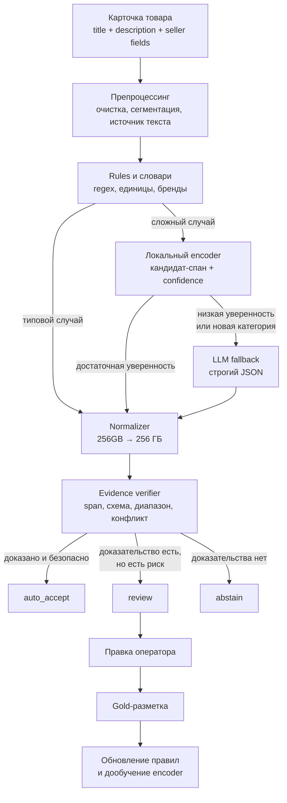
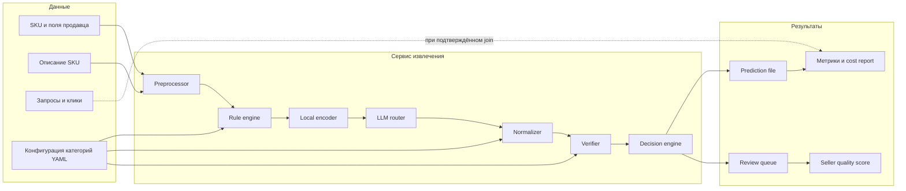
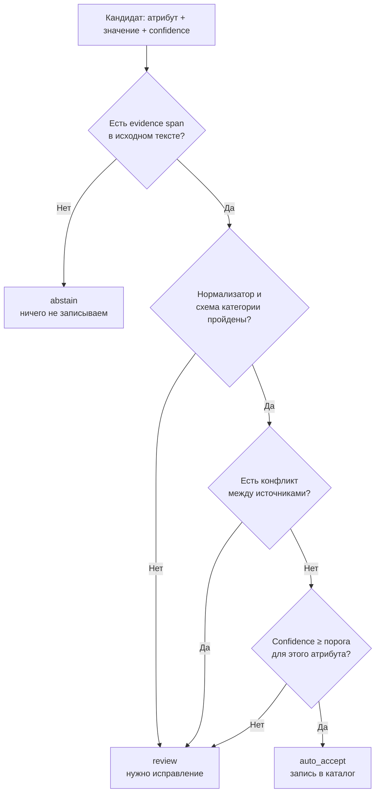
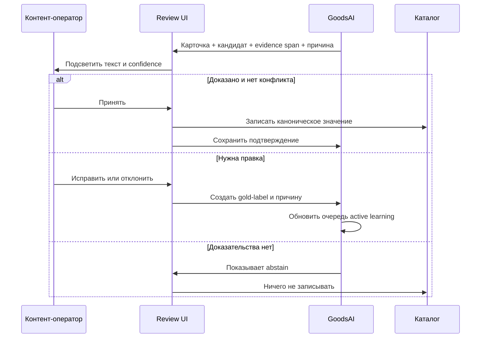
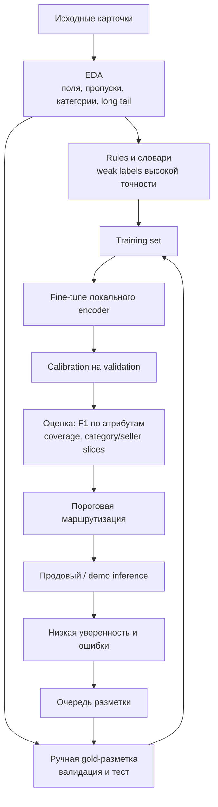
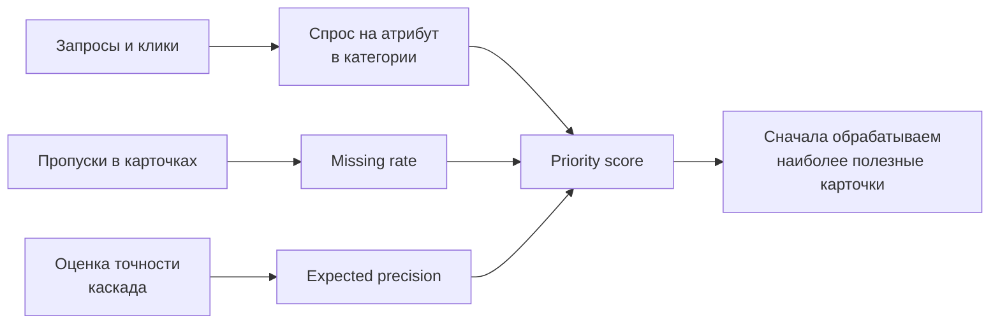
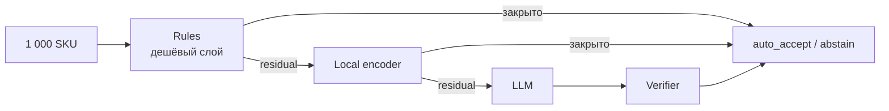
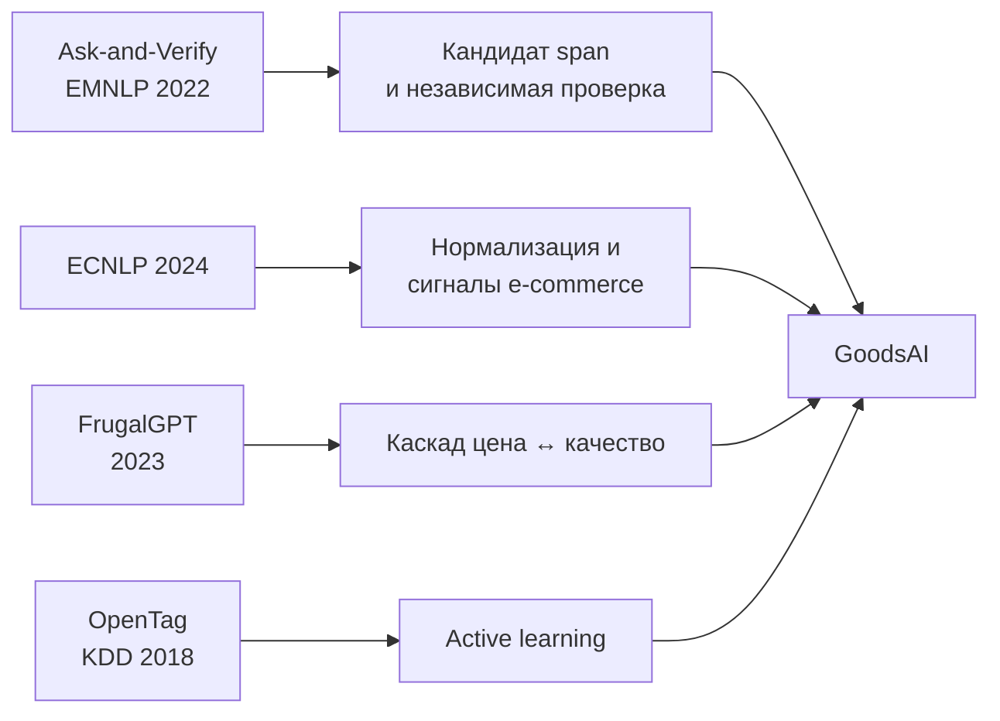

# GoodsAI — схемы архитектуры, сценариев и обучения

Диаграммы написаны в Mermaid и отображаются в GitHub. Для презентации экспортируйте нужную схему в SVG/PNG или перерисуйте в стиле слайдов, сохранив смысл. Не ставьте на один слайд больше одной схемы.

## 1. Главная схема гибридного пайплайна

**Для слайда «Основной сценарий решения».**



**Тезис к схеме:** «LLM не является источником истины. Она предлагает кандидата только для сложного остатка; финальное решение принимает валидатор».

---

## 2. Архитектура компонентов

**Для технического слайда или ответа на вопрос о реализации.**



### Контракт одного предсказания

```json
{
  "product_id": "sku_123",
  "attribute": "storage_capacity",
  "canonical_value": "256 ГБ",
  "confidence": 0.98,
  "evidence_text": "встроенная память 256GB",
  "source_field": "description",
  "producer": "rule_engine",
  "decision": "auto_accept",
  "rule_or_model_version": "rules-v1.0"
}
```

---

## 3. Маршрутизация и политика риска

**Для слайда «Почему это безопаснее LLM в лоб».**



| Исход | Когда применяем | Что сохраняем |
| --- | --- | --- |
| `auto_accept` | Evidence, schema и порог уверенности пройдены; конфликтов нет | Значение, span, источник, score, версия |
| `review` | Конфликт, серая зона confidence, неоднозначная нормализация | Кандидаты, причины, действие оператора |
| `abstain` | В тексте нет доказательства или validation не пройдена | Причину отказа и пустое значение |

---

## 4. Сценарий оператора

**Для продуктового слайда с прототипом.**



### Три обязательных примера в демо

1. `256GB` → `256 ГБ`: простая нормализация, `auto_accept`.
2. В title «чёрный», в description «графитовый»: конфликт, `review`.
3. Ёмкость батареи отсутствует: `abstain`.

---

## 5. Обучение локальной модели и контур данных

**Для технического слайда «Как улучшается encoder».**



### Принцип разметки

```text
Сначала размечаем не случайные карточки,
а случаи с конфликтом, низкой уверенностью и редкими значениями.
```

Это и есть **active learning**: один операторский ответ снижает риск на похожих карточках в следующей версии модели.

---

## 6. Порядок разработки: от данных к работающему гибриду

**Для плана работ и реалистичности внедрения.**

```mermaid
flowchart LR
    A[1. Распаковать датасет] --> B[2. EDA]
    B --> C[3. Контракт полей<br/>и YAML-схема категорий]
    C --> D[4. Rules baseline]
    D --> E[5. Normalizer + verifier]
    E --> F[6. Файл predictions<br/>и метрики baseline]
    F --> G[7. Локальный encoder]
    G --> H[8. Сравнение encoder<br/>с baseline]
    H --> I[9. LLM только на residual]
    I --> J[10. Cost report, demo<br/>и финальная презентация]
```



### Definition of Done для каждого этапа

| Этап | Минимальный проверяемый результат |
| --- | --- |
| EDA | Таблица полей, пропусков, категорий и распределений |
| Схема | YAML с обязательными полями, типами, единицами и порогами |
| Rules baseline | Предсказания с evidence span для типовых значений |
| Verifier | Набор тестов на конфликт, единицы, отсутствие значения |
| Local encoder | Результат на одном test split и срезы по атрибутам |
| LLM fallback | Число вызовов, прирост качества и стоимость на 1 000 SKU |
| Demo | 10–20 коварных карточек и review-экран |

---

## 7. Demand-aware приоритизация

**Использовать только после EDA, если `query_clicks` можно корректно связать с SKU или категорией.**



### Формула

```text
priority(sku, attribute) =
    normalized_query_demand(category, attribute)
    × missing_rate(category, attribute)
    × expected_precision(route, attribute)
```

Смысл: не расходовать одинаковый бюджет на всё, а сначала улучшать характеристики, которые вероятнее вернут товар в востребованный фильтр или поиск.

---

## 8. Экономика каскада

**Для слайда о стоимости. Цифры подставляются только после замера датасета и тарифа предоставленной LLM.**



### Формулы

```text
llm_call_rate = N_llm / N_all_sku

cost_1000 = local_compute_1000
          + N_llm_1000 × cost_per_llm_call
          + review_minutes_1000 × operator_rate

incremental_gain_llm = metric(hybrid) − metric(rules + local_encoder)
```

### Что оптимизируем

| Рычаг | Как ограничиваем стоимость |
| --- | --- |
| Отбор в LLM | Только низкая уверенность, конфликт или cold start |
| Кэш | Ключ: нормализованный текст + категория + атрибут + версия prompt |
| Контекст | Передаём только релевантные поля и список нужных атрибутов |
| Лимит | Cost cap на запуск и максимальная доля LLM-вызовов |
| Качество | Порог подбираем на validation отдельно для каждого атрибута |

---

## 9. Формулы качества и бизнес-ценности

### Per-attribute качество

```text
precision_a = TP_a / (TP_a + FP_a)
recall_a    = TP_a / (TP_a + FN_a)
F1_a        = 2 × precision_a × recall_a / (precision_a + recall_a)
```

`a` — конкретный атрибут. Отчёт строится отдельно для бренда, памяти, диагонали, цвета и других полей, а не только как одна общая accuracy.

### Безопасное покрытие

```text
valid_coverage_a =
  число карточек с валидно заполненным атрибутом a
  / число карточек, где атрибут a обязателен

precision_auto_accept =
  корректные auto_accept
  / все auto_accept
```

### Качество с учётом спроса

```text
traffic_weighted_quality =
  Σ(weight_a × quality_a) / Σ(weight_a)
```

`weight_a` строится из проверенных после EDA сигналов поискового трафика; до этого метрика не заявляется как готовая.

---

## 10. Научная опора схемы



- [Ask-and-Verify, EMNLP Industry 2022](https://aclanthology.org/2022.emnlp-industry.9/) — подтверждает паттерн генерации кандидата и его отдельной проверки.
- [Explicit Attribute Extraction in e-Commerce Search, ECNLP 2024](https://aclanthology.org/2024.ecnlp-1.13/) — пример нормализации и извлечения атрибутов в e-commerce.
- [FrugalGPT, 2023](https://arxiv.org/abs/2305.05176) — паттерн каскада, который выбирает более дорогой слой только когда он нужен.
- [OpenTag, KDD 2018](https://www.amazon.science/publications/opentag-open-attribute-extraction-from-product-profiles) — извлечение открытых атрибутов и активная разметка.

Не переносите численные результаты этих работ в собственные слайды: в презентации они обосновывают архитектурный выбор, а собственные метрики будут получены на датасете кейса.
