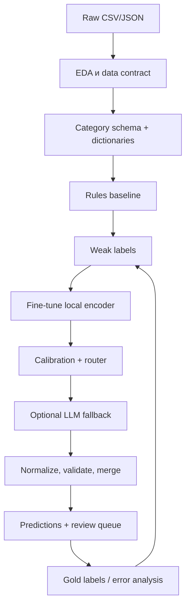

# GoodsAI — большой план реализации

## 0. Решение, которое строим

Строим **гибридный offline-пайплайн** для датасета хакатона. Его задача — получить текст карточки и вернуть нормализованные атрибуты с доказательством, confidence и решением `auto_accept`, `review` или `abstain`.

Мы не обучаем нейросеть с нуля. Используем три уровня:

1. **Собственные правила и справочники** — почти бесплатны, детерминированы, дают baseline и weak labels.
2. **Собственный дообученный encoder на наших мощностях** — основной ML-слой для свободного текста. Он компактнее LLM, дешевле в inference и адаптируется к словарю М.Видео.
3. **Модели хакатонного OpenAI-совместимого шлюза** — fast model для массового residual set и strong model для редких конфликтных формулировок. Их ответы никогда не записываются без independent validation.



## 1. Первый шаг: скачать данные и зафиксировать неизвестное

В канале кейса организаторы подтвердили, что датасет доступен в описании кейса. Скачиваем его и сразу начинаем EDA; не ждём дополнительной выдачи данных.

В первый час после загрузки зафиксировать в `docs/data_contract.md`:

- идентификатор SKU, категория, продавец и наличие кликов;
- поля title, description, seller attributes;
- формат целевых атрибутов: списки, JSON или колонки;
- наличие категорий, обязательных полей, справочников и span-разметки;
- лимиты, тарифы, доступность fast/strong моделей и режим JSON-ответа в хакатонном шлюзе;
- доступное железо: CPU, GPU, RAM, интернет.

До этой проверки не выбирать окончательно модель, пороги и целевые F1. На VM шлюз доступен через OpenAI SDK без ручной передачи ключа; перед реализацией проверяем конкретные доступные модели и режим JSON на тестовых карточках.

## 2. Поэтапный план работы

### Этап A. EDA и честный split

**Цель:** понять данные и исключить красивую, но ложную метрику.

Сделать:

1. Проверить размер, типы столбцов, пропуски, битые JSON и дубликаты.
2. Посчитать распределения категорий, продавцов, атрибутов и значений; выделить long tail.
3. Проверить, есть ли один товар с разными SKU/продавцами и какие поля конфликтуют.
4. Выделить train/validation/test по `product_id` или семейству модели, а не случайно по строкам.
5. Сделать ручной gold-set: минимум по несколько десятков примеров на критичные атрибуты и категории; включить сложные, редкие и конфликтные карточки.

**Готово, когда:** есть `reports/eda.md`, фиксированный `splits.json`, таблица пропусков и описание данных.

### Этап B. Схема и справочники

**Цель:** система знает, какие поля допустимы и как их нормализовать.

Создать `configs/categories.yaml`:

```yaml
smartphone:
  required_attributes:
    storage_capacity:
      type: number_with_unit
      units: [ГБ, ТБ]
      allowed_range: [16, 2048]
    screen_diagonal:
      type: number_with_unit
      units: [дюйма]
    color:
      type: enum
      dictionary: colors_ru_v1
```

Создать словари брендов, цветов, единиц, сокращений, транслитераций и синонимов. Каждый словарь — versioned file, а не скрытая логика в prompt.

**Готово, когда:** как минимум две ключевые категории имеют manifest и unit tests для 20–30 нормализаций.

### Этап C. Rules baseline

**Цель:** быстро показать ценность без тяжёлой нейросети.

Реализовать регулярные выражения и парсеры для:

- памяти (`256 GB`, `256гб`, `0.25TB`);
- диагонали (`6.7\"`, `6,7 дюйма`);
- батареи (`4000 mAh`, `4000 мА·ч`);
- брендов и моделей из title;
- цветов из словаря с безопасным мэппингом.

Каждое правило возвращает span, raw value, canonical value, source, score и reason. Не найдено доказательство — не возвращать кандидат.

**Готово, когда:** E1 baseline выдаёт predictions.jsonl и per-attribute метрики на одном validation split.

### Этап D. Weak labels и gold labels

**Цель:** дать модели данные без полной ручной разметки всего каталога.

1. Если структурированное поле продавца совпало с текстом, сформировать BIOES-метку span.
2. Добавить только высокоточные rule matches.
3. Записать provenance каждой метки: какое правило/поле её породило.
4. Не включать weak labels в final test.
5. Собрать ручную разметку для gold validation/test и отдельно выбрать uncertain cases для следующего раунда.

**Важно:** weak labels ускоряют старт, но не являются истиной. Их ошибки проверяются только на ручном gold-set.

### Этап E. Собственная дообученная модель

**Базовый выбор:** русскоязычный BERT-подобный encoder для token classification.

Вход:

```text
[TITLE] смартфон Samsung ... [SELLER] память 256GB [DESCRIPTION] ...
```

Выход: BIOES-теги `B-STORAGE`, `I-STORAGE`, `B-COLOR` и так далее.

План:

1. Дообучить на weak train + ручных train labels.
2. Сохранить checkpoint, tokenizer, config, seed и commit hash данных.
3. Посчитать span exact-match P/R/F1 и canonical-value P/R/F1.
4. Сравнить с E1 rules baseline.
5. Если категорий/атрибутов слишком много, параллельно протестировать QA-style модель `attribute + text → span`.

**Когда использовать LoRA:** только для генеративной LLM, которую команда запускает локально. Для компактного BERT она обычно не нужна как первая сложность; важнее качественные данные и честная оценка.

**Готово, когда:** E2 показывает таблицу сравнения E1/E2 и error analysis минимум из 30 ошибок.

### Этап F. Модели хакатонного шлюза как fallback

LLM нельзя пускать «в лоб» на весь CSV. Создаётся `ModelProvider` adapter:

```python
class AttributeFallbackProvider:
    def extract(self, text, requested_attributes, schema) -> list[Candidate]: ...
```

На VM адаптер создаёт OpenAI-совместимый клиент через `OpenAI()` без аргументов. Router вызывает fast model шлюза только если rules и encoder не дали `auto_accept`; strong model — только после fast model при конфликте или новой категории. Имена моделей передаются конфигурацией, ключи не попадают в Git или frontend. Детали: [HACKATHON_LLM_GATEWAY.md](HACKATHON_LLM_GATEWAY.md).

Prompt должен требовать строго JSON и запрещать догадки:

```text
Возвращай только значение, которое дословно подтверждается входным текстом.
Для каждого значения верни evidence_text и границы span.
Если доказательства нет, верни abstain.
```

Затем валидатор сам ищет `evidence_text` в оригинале. Не найдена подстрока — результат удаляется.

**Готово, когда:** E5 показывает прирост только на residual set, процент вызовов, отказы валидатора, p95 latency и стоимость/1 000 SKU.

### Этап G. Merger, confidence и ручная проверка

Приоритет источников:

1. подтверждённое структурированное поле продавца;
2. точное правило;
3. local encoder после нормализации и калибровки;
4. fast model шлюза после independent validation;
5. strong model шлюза после independent validation.

Если источники расходятся и нет бизнес-правила приоритета, выход — `review`, а не выбор случайного значения. Порог уверенности настраивается на validation так, чтобы максимизировать coverage при целевой precision auto-accept.

### Этап H. Финализация

Собрать predictions, metrics, cost report, error analysis, демо review UI, README и презентацию. Прогнать всё одной командой из чистого окружения.

## 3. Логика smart router

```text
for each (SKU, required_attribute):
  candidate = exact_rule_or_seller_match()
  if candidate.is_grounded and candidate.is_valid:
      accept(candidate)
  else:
      candidate = local_encoder.extract()
      if candidate.is_grounded and candidate.confidence >= T_high and valid(candidate):
          accept(candidate)
      elif llm_budget_available and no_cache_hit:
          candidate = fallback_llm.extract()
          if grounded_and_valid(candidate):
              review_or_accept_by_calibrated_confidence(candidate)
          else:
              abstain()
      else:
          review_or_abstain()
```

Router хранит `content_hash`, `schema_version`, `dictionary_version`, `model_version`, `prompt_version`. Это делает результат воспроизводимым и экономит повторные вызовы.

## 4. Как экономим собственные ресурсы

| Ресурс | Что делаем |
| --- | --- |
| GPU на обучении | Начинаем с компактного encoder-а; используем mixed precision; LoRA только при работе с генеративной локальной LLM |
| GPU/CPU на inference | Rules-first; encoder только для неразрешённых полей; batching по категории |
| API/LLM calls | Residual routing, cache, лимит вызовов, короткий schema-constrained JSON |
| Токены LLM | Передаём title/description + нужные поля + маленький category dictionary; не весь каталог и не длинные chain-of-thought |
| Время разметки | Weak labels + active learning вместо случайной разметки |
| Время оператора | Очередь только для конфликтов/низкой уверенности с подсвеченным доказательством |

## 5. Метрики, которые должны быть в финале

### Качество

- Per-attribute exact match precision, recall, F1.
- Coverage по каждому полю.
- Macro-F1, чтобы частые поля не скрыли long tail.
- Precision среди `auto_accept`.
- Review rate, abstain rate.

### Надёжность

- Доля auto-accept без найденного span — должна быть ноль.
- Ошибки normalizer/validator.
- Калибровочная кривая confidence и precision по диапазонам score.
- Качество по категориям, продавцам, редким значениям и новым категориям.

### Экономика

- Правила закрыли X% валидных случаев.
- Local encoder закрыл Y% residual set.
- LLM вызвана для Z% всех случаев.
- Token/cost/latency на 1 000 SKU.

`X`, `Y`, `Z` появляются только после измерения. Не подставлять желаемые числа на слайды.

## 6. Распределение ролей при команде из 4 человек

| Роль | Зона ответственности | Первые результаты |
| --- | --- | --- |
| Data/EDA | data contract, EDA, split, gold-set | отчёт и clean dataset |
| NLP/ML | rules, weak labels, encoder, metrics | baseline и fine-tuned model |
| Platform/LLM | router, provider adapter, cache, validator, predictions | end-to-end pipeline |
| Product/UX | schema, метрики ценности, review UI, презентация | бриф и прототип |

Если команда меньше, первым делом закрыть EDA → rules → normalizer/validator → metrics. Это уже жизнеспособный baseline. Затем добавить encoder. LLM fallback — третий по важности слой.

## 7. Бэклог по приоритету

### P0 — без этого решение не сдаётся

- Data contract, EDA, fixed split.
- Rules + dictionaries + normalizer.
- Predictions с evidence, confidence и decision.
- Metrics per attribute.
- README и воспроизводимый запуск.

### P1 — делает решение конкурентным

- Fine-tuned local encoder.
- Weak labels, gold-set, active learning.
- Schema validator, conflict resolver, calibration.
- Review prototype и error analysis.

### P2 — выделяет решение

- Budget-aware fast/strong model fallback с cache.
- Traffic-aware priority queue.
- Seller feedback concept.
- Cold-start playbook для новой категории.

## 8. Красные флаги на защите

| Вопрос эксперта | Плохой ответ | Наша позиция |
| --- | --- | --- |
| «Почему не LLM на всё?» | «Она умная» | Дорого и может выдумывать. LLM — fallback с evidence-only валидатором. |
| «Почему ваша уверенность правдива?» | «Так сказала модель» | Калибруем на validation и соединяем с жёсткими проверками. |
| «Как работаете с новым значением?» | «Его нет в словаре» | Span extraction + review + active learning добавляют значение контролируемо. |
| «Как узнаете бизнес-эффект?» | «У нас высокий F1» | F1/coverage — offline proxy; затем проверяем доступность в фильтрах и A/B impact. |
| «Почему не обучить модель с нуля?» | «Так сложнее» | Pretrained encoder даёт языковую базу; дообучаем лишь под домен и схему, экономя время/железо. |

## 9. Финальный чек-лист

- [ ] Есть data contract и EDA.
- [ ] Есть gold-test, который не использовался для разработки.
- [ ] Есть baseline на правилах.
- [ ] Есть собственная дообученная модель и сравнение с baseline.
- [ ] Ни один auto-accept не проходит без evidence span.
- [ ] Есть версия словаря, модели и prompt.
- [ ] Есть router cost report, если включали LLM.
- [ ] Есть predictions для всех SKU.
- [ ] README воспроизводит запуск.
- [ ] Презентация объясняет бизнес-ценность, ошибки и ограничения.
