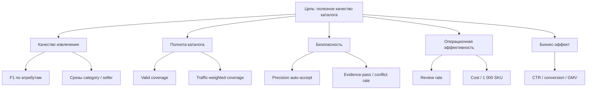
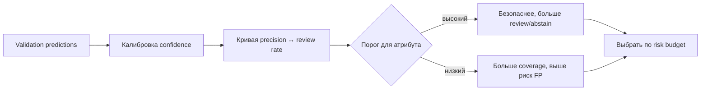

# GoodsAI — план измерений и экспериментов

**Цель документа:** определить, какие решения можно принимать по данным, а не по впечатлению от демо. Все целевые значения заполняются после EDA и baseline, поэтому в документе нет выдуманных процентов.

## 1. Дерево метрик

## 2. Словарь метрик

| Метрика | Формула / определение | Уровень | Для какого решения |
| --- | --- | --- | --- |
| Precision атрибута | `TP / (TP + FP)` | Атрибут, категория, продавец | Безопасно ли доверять источнику |
| Recall атрибута | `TP / (TP + FN)` | Атрибут, категория | Сколько нужных значений находим |
| F1 атрибута | Гармоническое среднее precision/recall | Атрибут | Сравнение rules, encoder, hybrid |
| Valid coverage | Валидно заполненные обязательные поля / обязательные поля | Атрибут, категория | Стало ли больше пригодных карточек |
| Precision auto-accept | Верные auto_accept / все auto_accept | Маршрут, атрибут | Установить threshold автозаписи |
| Review rate | Карточки/атрибуты в review / все | Категория, продавец | Планировать нагрузку оператора |
| Abstain rate | Отказы / все попытки извлечения | Атрибут, категория | Выявить пробелы rules и модели |
| Conflict rate | Конфликтующие источники / все карточки | Продавец, атрибут | Выявить проблемные данные |
| LLM-call rate | Вызовы LLM / SKU | Категория, маршрут | Управлять бюджетом |
| Cost / 1 000 SKU | Compute + LLM + review | Запуск / категория | Выбрать экономичный порог |
| Traffic-weighted quality | Взвешенное качество по подтверждённому трафику | Атрибут, категория | Приоритизировать backlog |

## 3. Минимальные наборы данных для оценки

| Набор | Назначение | Как получить | Чего нельзя делать |
| --- | --- | --- | --- |
| Train | Дообучение encoder | Размеченная часть + weak labels высокой точности | Не оценивать на нём итоговое качество |
| Validation | Пороги, калибровка, router | Отдельная размеченная выборка | Не использовать для финальных цифр в презентации |
| Test / gold set | Честная оценка | Отложенная ручная разметка по категориям | Не подбирать на нём пороги |
| Tricky set | Демо и регрессия | 10–20 вручную отобранных карточек | Не выдавать как репрезентативную метрику |

## 4. План офлайн-экспериментов

| Эксперимент | Сравниваем | Основная метрика | Условие перехода |
| --- | --- | --- | --- |
| E0. Data audit | Поля, пропуски, дубли, labels | Полнота data contract | Зафиксированы категории и обязательные поля |
| E1. Rules baseline | Rules + normalizer | Per-attribute precision/coverage | Есть рабочий prediction-файл и error log |
| E2. Encoder | Rules vs rules+encoder | ΔF1, особенно recall long tail | Encoder улучшает нужные срезы без ухудшения auto-accept precision |
| E3. Verifier | Hybrid до/после verifier | Precision auto-accept, conflict rate | Verifier обязателен, если снижает FP |
| E4. LLM residual | Local cascade vs +LLM | Incremental F1 / cost | LLM оправдана приростом на сложных случаях |
| E5. Threshold sweep | Несколько порогов per attribute | Precision–review trade-off | Выбран допустимый риск и бюджет |
| E6. Traffic prioritization | Очередь по спросу vs случайная | Traffic-weighted coverage | Только при подтверждённом join с кликами |

## 5. Шаблон таблицы результатов

Заполняется после запуска; пустые ячейки допустимы до получения baseline.

| Подход | Бренд F1 | Память F1 | Диагональ F1 | Цвет F1 | Valid coverage | Precision auto-accept | Review rate | LLM calls / 1k | Cost / 1k |
| --- | ---: | ---: | ---: | ---: | ---: | ---: | ---: | ---: | ---: |
| Rules + normalizer | — | — | — | — | — | — | — | 0 | — |
| Rules + local encoder | — | — | — | — | — | — | — | 0 | — |
| Hybrid + verifier | — | — | — | — | — | — | — | — | — |

## 6. Срезы, обязательные для отчёта

| Срез | Почему важен | Сигнал риска |
| --- | --- | --- |
| Атрибут | Общая метрика маскирует слабое поле | F1 по цвету или модели сильно ниже среднего |
| Категория | Электроника и long tail могут отличаться | Просадка на новой категории |
| Частота значения | Редкие значения сложнее | Recall на редких значениях ниже |
| Продавец | Качество входа неоднородно | Высокий conflict/review rate у конкретного продавца |
| Источник поля | Title, description, seller fields имеют разную надёжность | Ошибки концентрируются в одном источнике |
| Маршрут | Нужно понимать вклад каждого слоя | LLM не даёт incremental gain или rules дают FP |

## 7. Пороговые решения

Решение принимается **раздельно по атрибутам**. Например, модель и бренд могут иметь более строгий порог, чем малорисковый вторичный атрибут, но точные значения определяются validation-набором.

## 8. Переход от offline к бизнес-эффекту

| Этап | Что доказываем | Метод |
| --- | --- | --- |
| Offline | Модель корректно извлекает и нормализует | Gold set, F1, valid coverage |
| Shadow mode | Система стабильна на реальном потоке без записи в каталог | Сравнение с операторским решением |
| Limited rollout | Автозапись безопасна при заданном пороге | Мониторинг auto-accept и откатов |
| A/B search experiment | Заполненные поля помогают покупателю | CTR фильтров, conversion, zero-result / no-match сценарии |

## 9. План мониторинга после внедрения

| Частота | Что контролируем | Действие при отклонении |
| --- | --- | --- |
| Каждый запуск | Объём, маршруты, ошибки схемы, LLM budget | Остановить проблемный маршрут, включить cache/cap |
| Ежедневно | Coverage, review/abstain, conflicts | Анализ категории или продавца |
| По новой категории | Cold-start quality и ручная проверка | Временно review-first, добавить правила/разметку |
| По новой версии модели | Regression suite и gold-set метрики | Не выпускать при ухудшении ключевых срезов |

## 10. Необходимые вопросы к EDA

1. Какие ключи есть для соединения SKU, описаний и query clicks?
2. Как выражена категория и список обязательных атрибутов?
3. Где находятся truth labels и как устроены train/validation split?
4. Есть ли seller ID и исходные seller fields?
5. Есть ли дубликаты, пустые тексты, языковые варианты, разные единицы?
6. Сколько значений приходится на длинный хвост каждого атрибута?

См. [отчёт product discovery](PRE_DEVELOPMENT_PRODUCT_ANALYSIS.md) и [MVP-бэклог](MVP_BACKLOG_AND_DELIVERY_PLAN.md).
