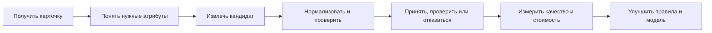

# GoodsAI — MVP-бэклог и план поставки

**Цель:** собрать работающий, воспроизводимый гибридный pipeline и доказать его качество. Приоритет определён продуктовым риском, а не привлекательностью технологии.

## 1. Карта пользовательских историй

## 2. Приоритизированный backlog

| ID | История / задача | Ценность | Приоритет | Готово, когда… |
| --- | --- | --- | --- | --- |
| P0-01 | Как аналитик, я вижу схему файлов, пропуски, категории и потенциальные ключи join | Убирает ложные допущения до разработки | P0 | Есть EDA-ноутбук и выводы по 6 вопросам из плана измерений |
| P0-02 | Как владелец каталога, я задаю обязательные поля и канонический формат в YAML | Новая категория настраивается без переписывания кода | P0 | Есть схема первой категории: поля, типы, единицы, словари, пороги |
| P0-03 | Как pipeline, я читаю title, description и seller fields, сохраняя источник каждого фрагмента | Дает evidence и диагностику | P0 | На выходе есть text spans и source_field |
| P0-04 | Как система, я извлекаю типовые значения правилами | Создаёт быстрый baseline | P0 | Есть rules для чисел, единиц, брендов и 10+ тестов |
| P0-05 | Как система, я нормализую значение и не принимаю невалидное | Защищает фильтры каталога | P0 | `256GB → 256 ГБ`, типы/диапазоны и ошибки покрыты тестами |
| P0-06 | Как оператор, я вижу evidence и могу принять/исправить/отклонить | Позволяет безопасно обработать остаток | P0 | Есть review-прототип и лог правки |
| P0-07 | Как команда, мы сравниваем результаты честно | Доказательство работоспособности | P0 | Predictions, F1/coverage и error analysis воспроизводимы |
| P1-01 | Как система, я использую local encoder для свободного текста | Повышает recall на long tail | P1 | Есть сравнение с baseline на едином test split |
| P1-02 | Как router, я вызываю LLM только для residual set | Сокращает стоимость | P1 | Лог маршрута, cache и LLM-call rate |
| P1-03 | Как verifier, я ловлю конфликты источников | Снижает false positives | P1 | Тест «чёрный / графитовый» уходит в review |
| P1-04 | Как менеджер, я вижу seller/category slices | Выявляет неравенство качества | P1 | Отчёт F1, coverage, review по сегментам |
| P2-01 | Как менеджер, я ранжирую исправления по спросу | Тратит бюджет на полезные поля | P2 | Подтверждён join click data и priority score |
| P2-02 | Как продавец, я получаю quality score | Устраняет источник плохих данных | P2 | Дашборд пропусков, конфликтов и правок |

## 3. Истории, которые сознательно не входят в MVP

| Идея | Почему отложена | Когда возвращаемся |
| --- | --- | --- |
| Распознавание по изображениям | Противоречит ограничению кейса «только текст» | После завершения кейса |
| RAG по всему каталогу | Не решает первичную задачу evidence из текущей карточки | Если появится потребность в внешних справочниках |
| Агентная система | Повышает сложность и непредсказуемость | После стабильного pipeline |
| Автоматическая публикация без контроля | Нужны проверенные risk thresholds | После shadow mode и мониторинга |
| Полноценный кабинет продавца | Не входит в обязательные артефакты | Как продуктовый следующий шаг |

## 4. План поставки по инкрементам

| Инкремент | Что делаем | Артефакт | Решение, которое он разблокирует |
| --- | --- | --- | --- |
| I. Understand | EDA, data contract, выбор первых категорий | EDA notebook + schema report | Что вообще можно обучать и измерять |
| II. Baseline | Rules, normalizer, verifier, tricky set | Predictions v0 + tests | Есть ли ценность без ML |
| III. Learn | Encoder, calibration, error analysis | Model comparison report | Где ML окупается |
| IV. Route | LLM fallback, cache, budget | Hybrid cost report | Нужна ли LLM и сколько она стоит |
| V. Show | Review UI, dashboard, презентация | Демо и итоговый PDF | Жюри видит рабочий процесс |

## 5. Технологический стек MVP

| Задача | Выбранный стек | Причина |
| --- | --- | --- |
| Анализ данных | Python 3.11, Polars/Pandas, DuckDB, Jupyter | Быстрая работа с Parquet и воспроизводимый EDA |
| Конфигурация | YAML + Pydantic | Проверяемая схема категорий и контрактов |
| Rules и нормализация | Python `re`, `rapidfuzz`, словари | Прозрачно, дёшево, легко тестировать |
| Local ML | PyTorch, Hugging Face `transformers`, русскоязычный BERT encoder | Дообучение извлечения span / token classification |
| Оценка | scikit-learn, pytest, фиксированный seed | Per-attribute метрики и регрессия |
| LLM fallback | Предоставленная кейсодателем модель через адаптер | Заменяемый интерфейс, без привязки к внешнему API |
| Demo | Streamlit или статический HTML | Быстрый review-экран без полноценного кабинета |
| Хранилище результатов | Parquet/CSV + versioned configs | Файл предсказаний и воспроизводимость |

## 6. RACI для маленькой команды

| Направление | Responsible | Accountable | Consulted | Informed |
| --- | --- | --- | --- | --- |
| EDA и data contract | Data/ML | Техлид | Product | Команда |
| Rules и normalizer | ML engineer | Техлид | Категорийный эксперт | Команда |
| Модель и оценка | ML engineer | Техлид | Product | Команда |
| Review flow и demo | Product / frontend | Product lead | ML | Команда |
| Презентация и питч | Product lead | Капитан | Вся команда | Команда |

Роли — функции, а не обязательные отдельные люди: один участник может закрывать несколько строк.

## 7. Definition of Ready и Definition of Done

### Definition of Ready для новой категории

- известны обязательные атрибуты;
- определены canonical units и недопустимые значения;
- есть минимум несколько примеров для ручной проверки;
- категория присутствует в конфигурации;
- определён риск: `auto_accept` допустим или сначала только review.

### Definition of Done для pipeline-версии

- запуск из README создаёт predictions-файл;
- prediction содержит `product_id`, attribute, canonical value, confidence, evidence, source и decision;
- есть per-attribute метрики на отложенном наборе;
- есть отчёт по review/abstain/LLM routes;
- tricky set проходит без регрессии;
- все заявленные цифры воспроизводимы из файлов запуска.

## 8. Риски исполнения и contingency plan

| Если… | Тогда… |
| --- | --- |
| Нет доступной LLM | Завершаем rules + encoder + verifier; LLM остаётся интерфейсным расширением |
| Encoder не улучшает baseline | Не скрываем результат: усиливаем rules, normalizer, gold set и error analysis |
| Слишком много категорий | Фокусируемся на приоритетных категориях после EDA, показываем масштабирование через YAML-схему |
| Нет labels | Создаём малый gold set, используем weak supervision, разделяем demo и честную оценку |
| Нет join с кликами | Не строим traffic score; считаем coverage и quality по атрибутам |

Связанные документы: [product discovery](PRE_DEVELOPMENT_PRODUCT_ANALYSIS.md), [план измерений](MEASUREMENT_AND_EXPERIMENT_PLAN.md), [диаграммы](GOODS_AI_DIAGRAMS.md).
