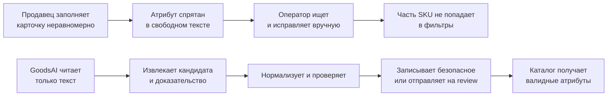
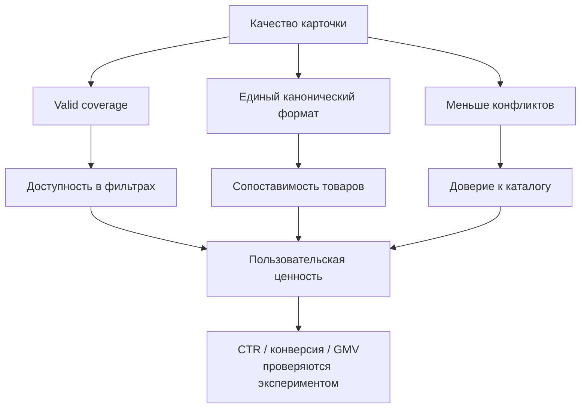

# GoodsAI — отчёт продуктового аналитика до разработки

**Версия:** 0.1 · **Статус:** продуктовые гипотезы до EDA и пользовательских интервью.  
**Основание:** требования кейса М.Видео, материалы кейсодателя и требования с платформы.  
**Назначение:** зафиксировать, какую бизнес-проблему решает MVP, для кого, как измеряется ценность и какие предположения нельзя выдавать за факт.

## 1. Executive summary

| Вопрос | Вывод |
| --- | --- |
| Проблема | Неполные или разноформатные характеристики не дают товару попасть в фильтры, поиск и дальнейшие процессы каталога. |
| Пользователь MVP | Контент-оператор качества каталога, который должен быстро и безопасно подтвердить предложенное значение. |
| Покупательская ценность | Покупатель находит больше релевантных товаров через фильтры и поиск. |
| Решение | Evidence-first гибрид: rules → local encoder → LLM только для сложного остатка → validator → `auto_accept/review/abstain`. |
| Почему сейчас | Каталог растёт по категориям и продавцам; ручная обработка плохо масштабируется, а LLM для каждой SKU дорога и рискованна. |
| Критерий успеха | Растёт **valid coverage** обязательных атрибутов при контролируемой precision `auto_accept`, review-нагрузке и стоимости. |

### Product thesis

> GoodsAI не пытается заполнить всё любой ценой. Он добавляет в каталог только доказанные текстом значения, а человек проверяет узкий поток риска.

## 2. Что известно, а что проверяем

| Утверждение | Статус | Как проверяем |
| --- | --- | --- |
| Входом служат title, description и данные продавца | Подтверждено требованиями кейса | Контракт входных таблиц в EDA |
| Изображения в решении не используются | Подтверждено требованиями кейса | Архитектурное ограничение |
| Нужны нормализация и confidence | Подтверждено требованиями кейса | Контракт prediction-файла |
| Архив содержит SKU, описания и query clicks | Подтверждено составом архива | EDA схем файлов и ключей соединения |
| Есть связка query → SKU/категория | Гипотеза | Проверить структуру `query_clicks` и возможность join |
| Есть ID продавца | Гипотеза | Проверить поля `skus.pkl` |
| Есть размеченные train/validation поля | Заявлено кейсом, требуется подтверждение | Найти target-поля и split в EDA |
| Автозаполнение повысит продажи | Гипотеза | Для хакатона: offline proxy; для продукта: A/B-тест поиска/фильтров |

## 3. Карта стейкхолдеров

| Стейкхолдер | Задача | Выгода | Риск, который для него важен |
| --- | --- | --- | --- |
| Контент-оператор | Проверять спорные характеристики | Меньше ручного поиска, понятное доказательство | Ложное автозаполнение, неудобный review |
| Категорийный менеджер | Поддерживать качество ассортимента | Видимость пропусков и проблемных категорий | Просадка качества на новом ассортименте |
| Продавец | Заполнять карточки | Понимание, какие поля мешают публикации | Несправедливые ошибки или непрозрачные требования |
| Поиск и рекомендации | Использовать структурированные признаки | Полнее индекс и лучше фильтрация | Ошибка распространяется на выдачу |
| Покупатель | Найти подходящий товар | Релевантные товары в фильтрах | Неверный атрибут и нерелевантная выдача |
| Финансы / операции | Управлять затратами обработки | Предсказуемая стоимость на объём SKU | LLM-траты и нагрузка на операторов |

## 4. Jobs To Be Done

| Роль | Когда… | Я хочу… | Чтобы… | Сигнал успеха |
| --- | --- | --- | --- | --- |
| Оператор | Приходит карточка с неполным описанием | Увидеть предложенный атрибут и точный фрагмент текста | Быстро принять безопасное решение | Меньше времени review, высокая точность принятых решений |
| Категорийный менеджер | Видит неполные обязательные поля | Понять, какие категории и продавцы создают долг | Планировать исправления по приоритету | Снижается valid gap по категории |
| Продавец | Карточка не попадает в фильтр | Получить понятную причину и формат значения | Исправить данные с первого раза | Снижается повторная доработка |
| Покупатель | Использует фильтр | Увидеть товары, подходящие под критерий | Выбрать товар без ручного поиска | Растёт доступность релевантных SKU |

## 5. Current state → target state

## 6. Карта ценности

**Важное различие:** valid coverage — непосредственно измеряемый результат продукта. Рост CTR, конверсии и GMV — бизнес-гипотеза, которую подтверждает только эксперимент после интеграции в поиск.

## 7. Сегментация проблемы

| Сегмент | Почему отличается | Что измеряем отдельно | Подход MVP |
| --- | --- | --- | --- |
| Частые категории | Достаточно примеров и правил | F1, coverage, доля auto-accept | Rules + local encoder |
| Long tail | Мало примеров, новые формулировки | Recall, abstain, review rate | LLM fallback + active learning |
| Новая категория | Может не быть готового словаря | Cold-start quality, доля review | YAML-схема + fallback |
| Продавец с низким качеством | Много пропусков и конфликтов | Seller quality score | Приоритизация review и обратная связь |
| Критичные для спроса атрибуты | Ошибка сильнее влияет на фильтры | Traffic-weighted valid coverage | Очередь по пользе после EDA |

## 8. Продуктовые принципы

1. **Доказательство раньше предсказания.** Значение без span в исходном тексте нельзя автоматически записывать.
2. **Нормализация — часть продукта.** `256GB`, `256 гб` и `0.25 TB` должны стать одним каноническим значением, если схема категории это допускает.
3. **Порог зависит от атрибута.** Ошибка в бренде и неоднозначный оттенок цвета имеют разную цену; единый threshold создаст неверный баланс.
4. **Пользователь видит причину решения.** Review-экран показывает источник, confidence и конфликт.
5. **LLM — дорогой инструмент, а не источник правды.** Она не вызывается для типовых случаев и проходит ту же проверку, что и все остальные источники.
6. **Нельзя скрывать неуверенность.** Корректный `abstain` ценнее ложного заполнения.

## 9. Гипотезы для проверки

| ID | Гипотеза | Метод проверки | Метрика решения | Возможное решение |
| --- | --- | --- | --- | --- |
| H1 | Rules закрывают существенную часть типовых числовых атрибутов | Прогон rules baseline | coverage и precision на gold set | Оставить rules первым слоем |
| H2 | Local encoder увеличивает recall на свободном тексте | Сравнение rules vs rules+encoder | ΔF1 по атрибутам | Дообучить и калибровать encoder |
| H3 | Verifier снижает ложные автопринятия | Ablation с verifier/без него | precision auto-accept | Сделать verifier обязательным gate |
| H4 | LLM нужна только для малой доли residual | Лог маршрутов | LLM-call rate, incremental F1 | Изменить пороги и cache |
| H5 | Примеры с низкой уверенностью полезнее случайной разметки | Сравнить наборы разметки | F1 на одинаковом annotation budget | Ввести active learning queue |
| H6 | Query clicks помогают расставить приоритеты | EDA ключей и распределений | Доступность надёжного join | Включить traffic-weighted очередь только после подтверждения |

## 10. Границы MVP

| В MVP | После подтверждения ценности |
| --- | --- |
| Извлечение текстовых атрибутов | Полноценный кабинет продавца |
| Ограниченный набор категорий после EDA | Автогенерация схем для всех категорий |
| Rules, normalizer, verifier, local encoder | Мультимодальное извлечение по фото |
| Review-прототип | Интеграция в боевой PIM/каталог |
| Файл предсказаний и отчёт метрик | A/B-тест поиска и атрибутивной рекламы |

## 11. Риски до начала разработки

| Риск | Ранний сигнал | Мера |
| --- | --- | --- |
| Нет разметки или целевых колонок | EDA не находит ground truth | Сделать rules baseline, создать малый gold set, применить weak labels |
| Нельзя соединить клики и SKU | Нет ключа или несопоставимые сущности | Не заявлять traffic-aware качество; оставить как roadmap |
| Слабое покрытие редких категорий | Большой review/abstain в long tail | Сегментные метрики, fallback и active learning |
| Внешняя LLM недоступна | Нет API/VM или лимитов | Модельный слой интерфейсный; MVP работает без него |
| Слишком много обязательных полей | Невозможно качественно закрыть всё в срок | Выбрать категории и атрибуты по EDA и бизнес-приоритету |
| Ложные факты в каталоге | Низкая precision auto-accept | Поднять пороги, включить verifier, отправлять в review |

## 12. Решения, которые нужно принять после EDA

1. Первые 2–3 категории и список обязательных полей.
2. Канонические форматы единиц, цветов, брендов и моделей.
3. Наличие label/split и способ построить gold set.
4. Доступность SKU–query/click join.
5. Требуемая target precision для `auto_accept` по каждому атрибуту.
6. Лимит LLM-вызовов и доступная инфраструктура.

См. также: [план измерений](MEASUREMENT_AND_EXPERIMENT_PLAN.md) и [MVP-бэклог](MVP_BACKLOG_AND_DELIVERY_PLAN.md).
