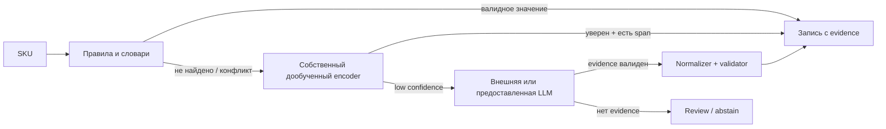

# GoodsAI — продуктовые улучшения и приоритизация

## Продуктовая позиция

Мы продаём бизнесу не «модель, которая извлекает текст», а безопасное увеличение полноты каталога. Успех означает: больше товаров попадает в полезные фильтры, оператор тратит время только на спорные случаи, вычислительные ресурсы не расходуются на очевидные карточки.

## MVP: что обязательно сделать

| Фича | Пользовательская ценность | Почему обязательна |
| --- | --- | --- |
| Evidence-first extraction | Оператор видит, откуда взялось значение | Убирает недоверие к ML и риск галлюцинаций |
| Три решения: accept/review/abstain | Бизнес управляет риском | Система умеет не угадывать |
| Нормализация значений | Поиск и фильтры получают единый формат | Иначе «256GB» и «256 ГБ» остаются разными фактами |
| Conflict review | Спорные источники не портят каталог | Нужен для title vs description vs seller attributes |
| Правила → encoder → LLM cascade | Меньше затрат при сохранении покрытия | Основной бизнес-смысл гибрида |
| Отчёт по атрибутам | Видно, где решение приносит пользу/ошибается | Общая accuracy скрывает проблемы |

## Усилители, которые заметят эксперты

### 1. Приоритизация по пользе для поиска

Не обрабатываем SKU одинаково. Строим очередь:

```text
priority = filter_or_query_traffic × missingness × expected_precision × attribute_importance
```

Если кликов нет, вместо traffic используем прокси: популярность категории и обязательность поля. На защите честно обозначаем это как прокси, а не как реальный трафик.

**Почему это выделяет решение:** команда показывает путь к GMV, а не только к model F1.

### 2. Интерфейс ручной проверки без лишней работы

Карточка review показывает:

- исходный title/description со span-подсветкой;
- значение до и после нормализации;
- источник: rule, encoder или LLM;
- confidence и причину review: конфликт, новая единица, низкий score;
- кнопки «принять», «исправить», «отклонить».

Каждое действие оператора создаёт label для следующего retrain. Прототип такого сценария уже есть в `prototype/index.html`.

### 3. Quality feedback для продавца

После подтверждения можно сформировать рекомендацию: «Для товара не указан объём памяти; в описании найдено `256 ГБ`, подтвердите поле». Это сокращает будущие пропуски у источника данных. В хакатонном MVP достаточно показать концепт, не обязательно строить кабинет продавца.

### 4. Карточка происхождения атрибута

Для каждого принятого факта хранить:

`value + raw value + span + source + model/dictionary version + timestamp + validation flags`.

Это делает решение объяснимым: можно откатить ошибочный словарь, найти все затронутые SKU и доказать, почему поле заполнилось.

### 5. Cold-start для новых категорий

Новая категория получает schema manifest и набор общих правил единиц. Сначала работает LLM fallback с evidence-only контрактом и review; после накопления подтверждений создаются weak labels и обучается/адаптируется local extractor. Это превращает «новая категория» из провала в контролируемую очередь запуска.

## Что не нужно делать в MVP

- Не использовать изображения: кейс их прямо исключает.
- Не строить сложную агентную систему и RAG по всему каталогу: для извлечения фактов важнее span, нормализация и валидация.
- Не обучать большую LLM с нуля: дорого, долго и не даёт доказательства в тексте.
- Не обещать GMV без продуктового эксперимента.
- Не добавлять десятки фич до честного baseline и EDA.

## Механика выгодного гибрида



Этот дизайн оставляет дорогую модель для residual set. LLM не является источником истины; она предлагает кандидата, который независимо проверяется.

## Метрики ценности фич

| Фича | Главная метрика | Защитная метрика |
| --- | --- | --- |
| Rules | Coverage без модели | Precision rules |
| Encoder | Δ recall на свободном тексте | Per-attribute precision |
| LLM fallback | Δ coverage residual set | Hallucination rejection rate, LLM-call rate |
| Review UI | Время/карточку, accept rate | Ошибки после принятия |
| Normalizer | Доля сведённых вариантов | Ошибки мэппинга |
| Traffic router | Полезно заполненные high-priority SKU | Coverage по малым продавцам |

## Какая история должна остаться у эксперта

> GoodsAI не заменяет человека неконтролируемой генерацией. Он направляет правила, собственную модель, LLM и оператора туда, где каждый из них сильнее. Поэтому каталог становится полнее без роста ложных атрибутов и без LLM-вызова на каждую карточку.
