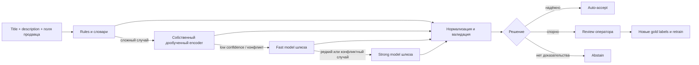

# GoodsAI

GoodsAI — гибридная система для автоматического заполнения обязательных характеристик товаров из текстовых карточек маркетплейса. Проект создан для кейса М.Видео.

## Что мы строим

Мы не строим «LLM, которая угадывает атрибуты». GoodsAI безопасно повышает полноту каталога: каждое автоматически принятое значение должно иметь доказательство в исходном тексте, пройти нормализацию и валидацию.

> Правила решают типовые случаи, собственный дообученный encoder понимает свободный текст, а модели хакатонного шлюза подключаются только к сложному остатку. Если факт нельзя доказать текстом — система не заполняет поле автоматически.

Это помогает товару появиться в нужных фильтрах, снижает ручную работу операторов и не требует дорого вызывать LLM для каждой карточки.

## Почему это решение полезно бизнесу

| Проблема каталога | Что делает GoodsAI | Какой эффект проверяем |
| --- | --- | --- |
| Пропущенные характеристики скрывают товары из фильтров | Находит и нормализует доказанные значения | Coverage обязательных полей |
| Разные написания ломают поиск | Сводит `256GB`, `256 gb`, `256 ГБ` к `256 ГБ` | Доля нормализованных вариантов |
| Ложный атрибут опаснее пропуска | Требует evidence span и отправляет сомнительные случаи на review | Precision среди auto-accept |
| LLM на всех SKU дорого масштабировать | Вызов LLM только после rules и encoder | LLM-call rate и стоимость на 1 000 SKU |
| Ошибки повторяются | Использует исправления оператора для active learning | Улучшение качества между итерациями |

## Функции, которые делают GoodsAI сильнее

| Фича | Что получает пользователь | Почему это важно для защиты |
| --- | --- | --- |
| Evidence-first extraction | Подсвеченный фрагмент, из которого взято значение | Решение объяснимо и не доверяет модели вслепую |
| `auto_accept / review / abstain` | Понятный маршрут для каждого результата | Система умеет отказаться от догадки |
| Conflict review | Явно показывает конфликт title, description и полей продавца | Снижает риск испортить фильтры |
| Конфигурация категорий | Новая категория задаётся YAML-схемой, единицами и словарями | Масштабирование без переписывания ядра |
| Журнал происхождения | Версии модели/словаря, span, источник и причина решения | Ошибки можно воспроизвести и исправить |
| Traffic-aware priority queue | Сначала обрабатываются важные для поиска незаполненные поля | ML связывается с бизнес-ценностью |
| Рейтинг качества продавцов | Видны источники пропусков и конфликтных данных | Решение улучшает не только последствия, но и первичные данные |

## Что покажем в демо

Демо состоит из 10–20 карточек и показывает полный путь от текста до решения. В набор обязательно входят:

- типовые значения: `256GB`, `6,7 дюйма`, `4000 mAh`;
- разные единицы и форматы: `0.25 TB`, `6.7\"`, `5000mah`;
- транслитерации и синонимы: `graphite`, `графитовый`, `Black`;
- конфликт источников: title содержит `чёрный`, описание — `графитовый`;
- контекстная ловушка: «чехол, совместимый с Samsung» не означает, что бренд товара — Samsung;
- значение, которого в тексте нет: корректный ответ системы — `abstain`;
- редкий бренд или новая модель: случай для encoder/LLM fallback и review.

В интерфейсе review оператор видит исходный текст с подсветкой, raw-значение, каноническое значение, источник, confidence и причину, почему карточка попала на проверку. Концептуальный экран: [prototype/index.html](prototype/index.html).

## Как дообучаем и используем нейросети

1. Правила и совпадающие структурированные поля продавца создают высокоточные weak labels.
2. Небольшой вручную размеченный gold-set задаёт честную проверку качества.
3. На собственных мощностях дообучается компактный русскоязычный encoder для token classification или QA-style извлечения span.
4. Через OpenAI-совместимый шлюз хакатона подключается fast model для массового остатка и strong model для редких конфликтных случаев. До включения в маршрут обе сравниваются с local encoder на gold-set.
5. Модель обязана вернуть JSON с атрибутом, значением, confidence и точной цитатой из карточки. Независимый валидатор снова ищет этот span в оригинальном тексте; нет span — результат отклоняется.
6. Исправления оператора попадают в следующий цикл разметки, обновления словарей и retrain.

Мы не обучаем большую LLM с нуля. Для локальной генеративной модели можно применять LoRA/QLoRA; для компактного encoder-а первым приоритетом остаются данные, normalizer и корректный test split.

## Метрики: качество, риск и экономика

На дашборде должны быть три блока.

| Блок | Метрики |
| --- | --- |
| Качество | Per-attribute precision, recall, F1, macro-F1, coverage |
| Риск | Precision `auto_accept`, review rate, abstain rate, доля конфликтов, доля auto-accept без evidence span = 0 |
| Экономика | Rule/encoder/LLM resolution rate, LLM-call rate, токены и стоимость на 1 000 SKU, p95 latency |

Метрики выводятся отдельно по атрибутам, категориям, редким значениям и продавцам. Общая accuracy не заменяет эту разбивку.

## Порядок работы

### P0 — обязательная основа

1. Скачать датасет из описания кейса, зафиксировать data contract и сделать EDA.
2. Построить честный train/validation/test split без утечки дублей.
3. Создать category schema, словари и normalizer.
4. Реализовать rules baseline и файл предсказаний с evidence.
5. Посчитать per-attribute метрики и описать ошибки.

### P1 — делает решение конкурентным

1. Собрать gold-set и weak labels.
2. Дообучить собственный encoder и сравнить его с rules baseline.
3. Добавить калибровку confidence, conflict resolver и review workflow.
4. Подготовить набор сложных карточек для демо.

### P2 — усиливает защиту

1. Подключить budget-aware LLM fallback с cache.
2. Построить отчёт по стоимости и маршрутизации.
3. Добавить traffic-aware priority queue.
4. Показать концепт seller quality score и обратной связи продавцу.

## Что сознательно не делаем

- Не используем изображения и OCR: в кейсе разрешён только текст.
- Не отправляем все карточки в LLM.
- Не записываем неподтверждённые значения в каталог.
- Не обещаем рост GMV без продуктового эксперимента.
- Не усложняем MVP агентной системой или RAG по всему каталогу.

## Документы проекта

| Документ | Содержимое |
| --- | --- |
| [PROJECT_CONTEXT.md](PROJECT_CONTEXT.md) | Продуктовый бриф по пяти вопросам чекпоинта |
| [PRODUCT_CHECKPOINT_PRESENTATION.md](PRODUCT_CHECKPOINT_PRESENTATION.md) | Готовая структура 10-слайдового продуктового брифа, речь и научная опора |
| [GOODS_AI_DIAGRAMS.md](GOODS_AI_DIAGRAMS.md) | Mermaid-схемы пайплайна, архитектуры, обучения, сценариев и формул |
| [PRE_DEVELOPMENT_PRODUCT_ANALYSIS.md](PRE_DEVELOPMENT_PRODUCT_ANALYSIS.md) | Product discovery: проблема, сегменты, JTBD, гипотезы, риски и границы MVP |
| [MEASUREMENT_AND_EXPERIMENT_PLAN.md](MEASUREMENT_AND_EXPERIMENT_PLAN.md) | План метрик, срезов, экспериментов и мониторинга |
| [MVP_BACKLOG_AND_DELIVERY_PLAN.md](MVP_BACKLOG_AND_DELIVERY_PLAN.md) | Product backlog, стек, этапы поставки и Definition of Done |
| [FIGMA_MAKE_PROMPT.md](FIGMA_MAKE_PROMPT.md) | Готовый промпт для Figma Make, список вложений и арт-дирекция презентации |
| [HACKATHON_LLM_GATEWAY.md](HACKATHON_LLM_GATEWAY.md) | Правила использования LLM-шлюза хакатона, модели, JSON-контракт и защита ключей |
| [presentation/GoodsAI_Product_Checkpoint_v3.pdf](presentation/GoodsAI_Product_Checkpoint_v3.pdf) | Актуальная PDF-презентация для продуктового чекпоинта |
| [presentation/GoodsAI_Product_Checkpoint_v3.pptx](presentation/GoodsAI_Product_Checkpoint_v3.pptx) | Актуальная редактируемая версия PowerPoint |
| [CASE_REQUIREMENTS_TRACEABILITY.md](CASE_REQUIREMENTS_TRACEABILITY.md) | Требования кейса и соответствие компонентов GoodsAI |
| [context/case/platform-requirements.md](context/case/platform-requirements.md) | Исходные требования кейса, сохранённые с платформы |
| [IMPLEMENTATION_MASTER_PLAN.md](IMPLEMENTATION_MASTER_PLAN.md) | Детальный план реализации, роли, эксперименты и чек-лист |
| [TECHNICAL_SPEC.md](TECHNICAL_SPEC.md) | Полное техническое ТЗ, контракты, риски и критерии приёмки |
| [PRODUCT_IMPROVEMENTS.md](PRODUCT_IMPROVEMENTS.md) | Продуктовые фичи и приоритеты |
| [RESEARCH_AND_ARCHITECTURE.md](RESEARCH_AND_ARCHITECTURE.md) | Научная опора, открытые проекты и тезисы защиты |
| [context/README.md](context/README.md) | Исходные материалы кейса и инструкции работы с архивом датасета |

## Статус

Репозиторий содержит продуктовую и техническую документацию, прототип review-интерфейса и план экспериментов. По сообщению организаторов датасет уже доступен в описании кейса, но пока не добавлен в рабочую копию. Фактический перечень обязательных полей и реализованный пайплайн ещё не добавлены. После загрузки данных первым шагом выполняются EDA и rules baseline; только затем фиксируются выбор модели и пороги.
