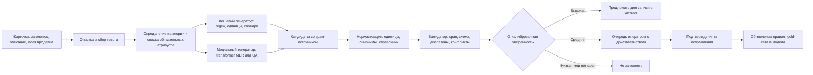

# GoodsAI — научная опора и архитектура решения

## Зачем этот документ

Это исследовательская записка для продуктового этапа кейса М.Видео. Она отвечает на вопрос «почему именно такой подход» и отделяет доказанные в публикациях идеи от проектных гипотез команды. Источники проверены 14 октября 2026 года.

Главный вывод: для заполнения товарных атрибутов не подходит схема «отправить каждую карточку в LLM и записать ответ». Практичный дизайн состоит из извлечения кандидатов, нормализации, проверки источника в тексте и маршрутизации по уверенности. Это соответствует ограничению кейса: не выдумывать характеристики и учитывать стоимость на масштабе.

## Что говорят исследования

| Работа | Что было проверено авторами | Как используем в GoodsAI |
| --- | --- | --- |
| [More, 2016 — Attribute Extraction from Product Titles in eCommerce](https://arxiv.org/abs/1608.04670) | Для коротких товарных заголовков полезно сочетать sequence labeling с нормализацией. | Начинаем с извлечения значений как последовательности токенов и не отделяем его от канонизации единиц и синонимов. |
| [Zheng et al., 2018 — OpenTag](https://www.amazon.science/publications/opentag-open-attribute-extraction-from-product-profiles) | BiLSTM-CRF с attention и active learning извлекал неизвестные ранее значения; на реальных доменах авторы сообщают F1 83% при сокращении объёма разметки в 3,3 раза. | Берём не конкретную устаревшую архитектуру, а два принципа: предсказывать текстовый span, а сомнительные примеры отправлять в разметку. |
| [Xu et al., 2019 — Scaling up Open Tagging](https://aclanthology.org/P19-1514/) | Отдельная NER-модель для каждого поля плохо масштабируется до тысяч атрибутов; авторы переводят задачу в машинное чтение с запросом-атрибутом. | Если атрибутов окажется много, тестируем один QA-style extractor: на вход подаём текст и имя требуемого поля, а не обучаем отдельную модель на каждое поле. |
| [Yan et al., 2020 — AdaTag](https://assets.amazon.science/9c/5f/13fa302c4691a5c44cefce5b4218/adatag-multi-attribute-value-extraction-from-product-profiles-with-adaptive-decoding.pdf) | Мультиатрибутное извлечение выигрывает от общего энкодера при сохранении атрибутной специфики декодирования. | Для обязательных полей одной категории сравниваем единый энкодер с отдельными головами, а не набор независимых моделей. |
| [Ding et al., 2022 — Ask-and-Verify](https://aclanthology.org/2022.emnlp-industry.9/) | Двухшаговый пайплайн «найди top-K span-кандидатов → отфильтруй ложные» улучшил F1 до 3,1 п.п. и масштабировался до тысяч атрибутов. | Это ключевой паттерн: генератор отвечает за полноту, валидатор — за точность. Он снижает риск ложных атрибутов в фильтрах. |
| [Malmasi et al., 2024 — Explicit Attribute Extraction in e-Commerce Search](https://aclanthology.org/2024.ecnlp-1.13/) | Transformer NER плюс двухэтапная нормализация работал в production real-time; слабые и синтетические метки были конкурентоспособны для части полей. | Для размеченного ядра используем transformer token classifier; правила и исторические структурированные поля — источник weak labels для старта. |
| [Khandelwal et al., 2023 — Large Scale Generative Multimodal Attribute Extraction](https://aclanthology.org/2023.acl-industry.29/) | Generative QA помогает с zero-shot и значениями, которых не было в обучении, но работа использует изображения. | В нашем кейсе не используем изображения. Берём только идею LLM/генеративной модели как fallback для новых категорий, а не как основной массовый путь. |

### Как корректно интерпретировать результаты статей

Нельзя переносить чужой F1 на датасет М.Видео: в работах отличаются категории, язык, разметка и правила оценки. В защите нужно говорить: «Мы опираемся на опубликованные архитектурные паттерны и проверяем их на предоставленном датасете», а не «статья гарантирует нам 83% F1».

## Что делают студенты и открытые команды

В открытых учебных работах повторяется тот же путь, но в более лёгкой реализации:

- [Stanford CS229, 2018](https://cs229.stanford.edu/proj2018/report/190.pdf): студенческий проект на датасете BestBuy сформулировал задачу как NER и сравнил SVM, Gradient Boosting и CRF для бренда, модели, цены и других полей. Это хороший пример честного baseline-сравнения, но не готовая production-архитектура.
- [Открытая BERT-реализация](https://github.com/mhilmiasyrofi/product-attribute-extraction): автор дообучает BERT для token classification и извлекает 16 типов атрибутов из товарных предложений. Подход полезен как воспроизводимый каркас: preprocessing → BIO-разметка → fine-tuning → извлечение spans.
- [Alibaba International GEC 2024 — winning submission](https://github.com/vincetyy/alibaba-gec-crashcourse): в публичном репозитории победной работы есть смешение специализированного BERT и LLM-подходов. Для нас это подтверждает выбор гибрида, но код и результаты нужно воспроизводить на своём датасете.

Общий рецепт учебных проектов: начать с правил и простого NER, затем показать, что именно даёт BERT/QA/LLM на одинаковом тестовом наборе. Мы используем этот подход, но добавляем обязательные для кейса guardrails: доказательство значения исходным текстом, нормализацию и human-in-the-loop.

## Архитектура GoodsAI

### 1. Вход и предобработка

Объединяем `title`, `description` и атрибуты продавца в размеченный текст, сохраняя поле и позицию каждого фрагмента. Приводим пробелы, разделители, регистр и распространённые обозначения единиц к единообразному виду, но храним исходный текст. Это позволяет показать оператору доказательство: «256 GB» → «256 ГБ».

### 2. Определение обязательной схемы

Если категория дана датасетом, используем её напрямую. Если нет — добавляем небольшой классификатор категории и показываем его точность отдельно. После категории выбираем только обязательные для неё атрибуты: для смартфона это не тот же набор, что для ноутбука. Такое сужение пространства вариантов уменьшает ошибки и цену инференса.

### 3. Кандидаты: каскад из трёх уровней

**Уровень A — правила и словари.** Regex и словари работают для объёма памяти, диагонали, ёмкости батареи, единиц измерения, известных брендов и цветов. Их сильные стороны — почти нулевая стоимость, прозрачность и хороший baseline.

**Уровень B — transformer extractor.** Рекомендуемый основной эксперимент — дообучить `ai-forever/ruBert-base` как token-classification модель с BIO-тегами. Модель подходит русскому тексту; её карточка опубликована с лицензией Apache-2.0. Альтернативный эксперимент при большом числе полей — multilingual `mDeBERTa-v3-base` в QA-style постановке «текст + атрибут → span». Выбор между ними делаем только по метрикам предоставленного датасета.

**Уровень C — LLM fallback.** Применяется только для новых категорий, редких формулировок или конфликтов, которые не решили A/B. Вход LLM содержит схему нужных полей и разрешённые значения/единицы. Выход — строгий JSON: `value`, точная цитата `evidence`, позиция span и `abstain`. Если `evidence` нельзя найти в исходном тексте, кандидат отклоняется. LLM не имеет права дополнять отсутствующие характеристики.

### 4. Нормализация и валидация

Нормализатор приводит «256gb», «256 GB» и «256 гб» к `256 ГБ`; «graphite», «графитовый» — к справочному значению, если оно однозначно. Валидатор проверяет:

- что значение связано с текстовым span;
- допустимость единицы и диапазона для атрибута;
- попадание в категориальный словарь, если он закрытый;
- отсутствие конфликта между источниками или явную фиксацию конфликта;
- соответствие JSON-схеме и обязательному типу поля.

Это реализация принципа Ask-and-Verify: не доверять генератору автоматически.

### 5. Уверенность и маршрутизация

Уверенность — не просто вероятность модели. Для каждого кандидата сохраняем `model_score`, результаты проверок и итоговый `confidence`, откалиброванный на валидации. Порог выбираем по кривой «precision среди автоматически принятых / coverage», а не произвольно. В первом прототипе можно задать два порога по валидационной выборке:

| Итог | Условие | Действие |
| --- | --- | --- |
| Auto-accept | есть span, все проверки пройдены, confidence ≥ T_high | подготовить запись в каталог |
| Review | span есть, но confidence между T_low и T_high или источники конфликтуют | показать оператору значение и цитату |
| Abstain | нет span, проверка не пройдена или confidence < T_low | не заполнять поле |

Порог `T_high` настраивается так, чтобы максимизировать coverage при целевой высокой precision. Конкретное число нельзя честно называть до оценки на данных.

## План экспериментов: что реально сделать до защиты

| Версия | Метод | Какой вопрос закрывает |
| --- | --- | --- |
| V0 | Правила, единицы, словари | Какой минимум качества и coverage доступен без обучения? |
| V1 | ruBERT token classification + V0 | Поднимает ли контекстная модель recall на свободном тексте и хвосте? |
| V2 | V1 + нормализация + валидатор | Сокращает ли верификация ложные атрибуты при допустимой потере coverage? |
| V3 | QA-style extractor для широкого набора полей | Масштабируется ли подход на много атрибутов лучше, чем BIO-теги? |
| V4 | LLM только на остатке V2/V3 | Улучшает ли fallback качество новых категорий без неприемлемой цены и роста ложных значений? |

На продуктовый чекпоинт достаточно показать V0, целевую архитектуру V1–V4 и заранее определённый экспериментальный план. Не нужно заявлять, что V1–V4 уже работают, если датасет ещё не получен.

## Метрики и срезы

Основные метрики: exact-match precision, recall и F1 для каждого атрибута после нормализации; coverage; доля ложных атрибутов среди auto-accept; доля Review; средняя стоимость и задержка на карточку.

Обязательные срезы: категория, атрибут, редкие значения, длина описания, продавец/сегмент продавца и новые категории. Для бизнес-приоритизации можно дополнительно посчитать traffic-weighted F1, если в датасете есть клики по запросам или важность фильтров.

**Честный сплит:** по возможности разделить данные так, чтобы одинаковая модель товара или почти одинаковые карточки не попали одновременно в train и test. Иначе высокая метрика может быть следствием утечки дублей. Отдельно сделать cold-start срез: значения и/или категории, отсутствовавшие в обучении.

## Тезисы для защиты

### Короткая версия — 40 секунд

> Мы решаем не задачу генерации текста, а задачу безопасного заполнения поискового индекса. Поэтому строим гибридный каскад: правила быстро извлекают типовые параметры, transformer покрывает свободный текст, а LLM подключается только к редким и новым случаям. Каждое значение обязано иметь цитату из карточки, пройти нормализацию и валидацию. Мы разделяем покрытие и точность: надёжные значения идут в каталог, сомнительные — оператору, неподтверждённые — не записываются. Такой паттерн опирается на OpenTag, Ask-and-Verify и production-подходы к нормализации атрибутов.

### Если спросят «почему не только LLM?»

> LLM полезна для cold-start и длинного хвоста, но в кейсе запрещено выдумывать характеристики, а вызов на каждую карточку дорог. Поэтому LLM — fallback с JSON-схемой, разрешёнными значениями и обязательным evidence span. Основной поток обрабатывают дешёвые и проверяемые компоненты.

### Если спросят «почему NER/QA, а не классификация?»

> Классификация ограничена заранее известным списком значений и плохо обрабатывает новые модели и редкие характеристики. Span extraction возвращает фрагмент исходной карточки, поэтому его можно проверить. QA-style постановка помогает, когда атрибутов много: один extractor получает имя требуемого поля как запрос.

### Если спросят «как вы контролируете галлюцинации?»

> Мы не принимаем значение без подтверждения в исходном тексте. После извлечения проверяем span, единицы, словарь и конфликт источников. Низкая уверенность означает abstain или ручную проверку, а не заполнение карточки.

### Если спросят «как докажете эффект для бизнеса?»

> Сначала измерим качество данных: per-attribute F1, coverage и precision auto-accept. Затем при наличии продуктового контура проверим, растёт ли доступность товара в фильтрах и меняются ли CTR, конверсия и GMV в A/B-тесте. Модельную метрику не выдаём за бизнес-эффект.

## Ограничения и решения команды

- Датасет может не иметь span-разметки. Тогда сначала создаём слабые метки из надёжных структурированных полей/правил, а небольшой набор размечаем вручную как gold set.
- Данные могут быть недостаточны для стабильного fine-tuning. Тогда основной результат — сильный rules baseline с нормализацией, а transformer запускаем как сравнение на доступной разметке.
- Перечень атрибутов ещё неизвестен. Архитектура параметризуется схемой категории; фактические правила и модельные головы добавляются после EDA.
- Концепция не использует изображения, потому что это прямое ограничение кейса.

## Библиография

1. Ajinkya More. 2016. [Attribute Extraction from Product Titles in eCommerce](https://arxiv.org/abs/1608.04670).
2. Guineng Zheng, Subhabrata Mukherjee, Xin Luna Dong, Feifei Li. 2018. [OpenTag: Open Attribute Value Extraction from Product Profiles](https://www.amazon.science/publications/opentag-open-attribute-extraction-from-product-profiles).
3. Huimin Xu et al. 2019. [Scaling up Open Tagging from Tens to Thousands](https://aclanthology.org/P19-1514/).
4. Jun Yan et al. 2020. [AdaTag: Multi-Attribute Value Extraction from Product Profiles with Adaptive Decoding](https://assets.amazon.science/9c/5f/13fa302c4691a5c44cefce5b4218/adatag-multi-attribute-value-extraction-from-product-profiles-with-adaptive-decoding.pdf).
5. Yifan Ding et al. 2022. [Ask-and-Verify: Span Candidate Generation and Verification for Attribute Value Extraction](https://aclanthology.org/2022.emnlp-industry.9/).
6. Shervin Malmasi et al. 2024. [Explicit Attribute Extraction in e-Commerce Search](https://aclanthology.org/2024.ecnlp-1.13/).
7. Prashant Khandelwal et al. 2023. [Large Scale Generative Multimodal Attribute Extraction for E-commerce Attributes](https://aclanthology.org/2023.acl-industry.29/).
8. Mikhail Sidorov. 2018. [Attribute extraction from eCommerce product descriptions — Stanford CS229 project](https://cs229.stanford.edu/proj2018/report/190.pdf).
