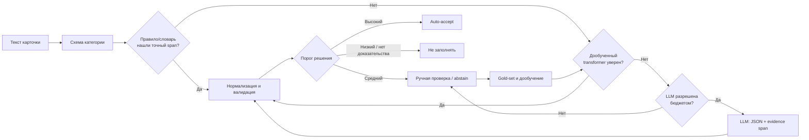

# ТЗ: GoodsAI — гибридное извлечение товарных атрибутов

**Версия:** 0.1 · **Статус:** проектное ТЗ до получения датасета · **Ограничение кейса:** только текст карточки; изображения, OCR и мультимодальные модели не входят в решение.

## 1. Продуктовая гипотеза и отличие решения

GoodsAI — не «LLM, которая заполняет карточки», а **Evidence-First Adaptive Cascade**: каскад выбирает самый дешёвый метод, который может извлечь значение и доказать его исходным текстом.



**Главная отличительная гипотеза:** мы оптимизируем не только F1, но и безопасное покрытие на рубль/запрос LLM. Каждая автоматическая запись имеет `evidence_span`, версию справочника и причину решения. Поэтому ошибку можно воспроизвести, отменить и использовать для обучения.

| Обычное решение | GoodsAI |
| --- | --- |
| Вызывает LLM для всех карточек | Вызывает LLM только для остатка после правил и модели |
| Возвращает значение без происхождения | Каждое значение обязано иметь точный фрагмент исходного текста |
| Вероятность модели равна уверенности | Уверенность калибруется, затем объединяется с проверками |
| Любой ответ записывается в каталог | Три исхода: auto-accept, review, abstain |
| Ошибки исправляются вручную разово | Подтверждения пополняют gold-set, правила и датасет для retrain |

## 2. На чём основан дизайн

1. [OpenTag (Amazon, KDD 2018)](https://www.amazon.science/publications/opentag-open-attribute-extraction-from-product-profiles) рассматривает извлечение как sequence tagging, использует active learning и показывает, что новые значения можно получать при ограниченной разметке. Берём span-извлечение и цикл активной разметки.
2. [Ask-and-Verify (EMNLP 2022)](https://aclanthology.org/2022.emnlp-industry.9/) разделяет поиск top-K кандидатов и фильтрацию ложных. Это прямой прототип нашего генератора + валидатора.
3. [OA-Mine (WWW 2022)](https://github.com/xinyangz/oamine) публикует код weak-supervision для поиска атрибутов и значений в открытом мире. Берём идею слабых меток для старта без дорогой ручной BIO-разметки.
4. [FrugalGPT (2023)](https://arxiv.org/abs/2305.05176) формализует LLM cascade: дешёвые модели обрабатывают простые запросы, дорогие — трудные. Авторы получили сопоставимое качество с лучшей моделью при существенно меньших затратах в своих экспериментах. Мы переносим принцип маршрутизации, а не их цифры на наш датасет.
5. [LoRA (2021)](https://arxiv.org/abs/2106.09685) предлагает parameter-efficient fine-tuning. Используем LoRA/QLoRA только если будем адаптировать генеративную open-source LLM; для компактного encoder-а сначала сравниваем обычный fine-tuning.
6. [Snorkel (VLDB)](https://www.vldb.org/pvldb/vol11/p269-ratner.pdf) показывает, как объединять шумные программные правила в weak labels. Это снижает стоимость начальной разметки, но требует чистого gold-set для контроля смещения.

Открытые примеры для изучения структуры проекта, а не переноса их метрик: [OA-Mine](https://github.com/xinyangz/oamine), [BERT и OpenTag для извлечения атрибутов](https://github.com/rishav771/Product-Attribute-Extraction), [token-classification BERT](https://github.com/mhilmiasyrofi/product-attribute-extraction), [e-commerce pipeline с rules + transformer + merger](https://github.com/Lavanya-Jothivel/Intelligent-Product-Information-Extraction-System).

## 3. Границы и цели

### Входит в решение

- Заголовок, описание и поля продавца из предоставленного CSV/JSON.
- Обязательные атрибуты для известной категории, канонизация значений и единиц.
- Извлечение, доказательство в тексте, оценка уверенности, ручная проверка и петля обратной связи.
- Воспроизводимый offline-пайплайн для датасета хакатона.

### Не входит в решение

- Изображения, OCR, video, web-scraping, реальные записи в production-каталог.
- Утверждения о CTR, конверсии или GMV без A/B-теста.
- Генерация отсутствующих в карточке значений: если доказательства нет, результат — `abstain`.

### Цели качества

До EDA не фиксируем вымышленные проценты. Пороговые значения утверждаются после V0 baseline на валидации. Приёмочные метрики:

- exact-match precision, recall и F1 **после нормализации** для каждого атрибута;
- coverage: доля карточек, где поле безопасно заполнено;
- precision среди `auto_accept`;
- доля `review` и `abstain`;
- LLM-call rate, токены/карточку, стоимость/1 000 карточек и p95 latency;
- качество по категориям, редким значениям и продавцам.

## 4. Контракты данных

### Входной контракт

Минимальная логическая схема; реальные названия колонок адаптируются после EDA.

```json
{
  "product_id": "sku_123",
  "category_id": "smartphone",
  "title": "Смартфон Samsung Galaxy S24 256GB Black",
  "description": "...",
  "seller_attributes": {"memory": "256 gb"}
}
```

### Выходной контракт

Один объект на предсказание атрибута. `raw_value` и `evidence_text` сохраняются неизменёнными для аудита; `canonical_value` используется дальше.

```json
{
  "product_id": "sku_123",
  "attribute": "storage_capacity",
  "raw_value": "256GB",
  "canonical_value": "256 ГБ",
  "evidence_text": "Samsung Galaxy S24 256GB Black",
  "evidence_start": 20,
  "evidence_end": 25,
  "source": "rule|encoder|llm",
  "model_version": "encoder_v1",
  "dictionary_version": "taxonomy_v1",
  "model_score": 0.96,
  "validation_flags": [],
  "confidence": 0.94,
  "decision": "auto_accept|review|abstain"
}
```

**Инвариант:** `evidence_text` должен быть точной подстрокой одного из входных текстовых полей. Если инвариант нарушен, решение автоматически становится `abstain`.

## 5. Архитектура и алгоритм маршрутизации

### 5.1 Схема категории

По `category_id` загружается manifest: обязательные поля, тип значения, допустимые единицы, допустимые значения и диапазоны. Пример: для смартфона `brand`, `model`, `storage_capacity`, `screen_diagonal`, `battery_capacity`, `color`.

Если `category_id` отсутствует, отдельный классификатор категории выдаёт top-1 + confidence. При неуверенной категории извлечение не выполняется автоматически: карточка идёт в `review`, поскольку ошибочная категория меняет смысл полей.

### 5.2 Tier 1: правила и справочники

Правила решают детерминированные паттерны: размеры, память, батарея, диагональ, разрешения, известные бренды и единицы. Словарь нормализует синонимы и написания (`256GB` → `256 ГБ`).

Правило проходит далее, только если найден текстовый span, допустима единица и нет конфликта с более приоритетным полем продавца. Это быстрый и дешёвый слой; он одновременно создаёт weak labels.

### 5.3 Tier 2: дообученный encoder

**Основной вариант:** `ai-forever/ruBert-base` или сопоставимая русскоязычная encoder-only модель в token-classification постановке с BIOES-тегами. На вход подаются размеченные границами полей `title`, `seller_attributes`, `description`; на выходе — spans по нужным атрибутам.

**Вариант для множества полей:** QA-style extractor: `[ATTR] storage_capacity [SEP] текст карточки`, который предсказывает начало и конец span. Он устраняет необходимость поддерживать отдельный класс/голову для каждого атрибута.

**Обучение:**

1. Создать gold-set с ручной разметкой spans и canonical values, стратифицированный по категории, атрибуту, продавцу и редкости.
2. Создать weak labels только из строгих правил и существующих структурированных полей, когда значение найдено в тексте без неоднозначности.
3. Обучить первый encoder на weak labels; проверить исключительно на ручном gold-set.
4. Взять примеры с высокой неопределённостью, конфликтом и ошибками, разметить вручную и добавить в train.
5. Повторить обучение, не изменяя test portion gold-set.

Для такого encoder-а сначала достаточно обычного fine-tuning. Если команда решит дообучать генеративную LLM, применяем LoRA/QLoRA: базовые веса заморожены, обновляются небольшие адаптеры. Это экономит GPU-память, но не заменяет качественную разметку.

### 5.4 Tier 3: LLM fallback, не «LLM на всё»

LLM запускается только если одновременно выполнены условия:

1. Tier 1 не дал валидного значения либо обнаружил конфликт;
2. Tier 2 имеет confidence ниже `T_high` либо не нашёл span;
3. карточка не была уже обработана с тем же `content_hash`, `schema_version` и `prompt_version`;
4. не исчерпан дневной/экспериментальный бюджет вызовов.

LLM получает **только** текст карточки, список требуемых полей и компактный фрагмент релевантного справочника. Она возвращает строго JSON-массив с `attribute`, `raw_value`, `evidence_text`, `evidence_start`, `evidence_end`, `abstain_reason`. Используем нулевую температуру. Затем независимый детерминированный валидатор повторно находит span в исходном тексте.

Запрещено: просить LLM «догадаться», передавать ей весь справочник каталога, принимать значение без span или трактовать её самооценку как итоговую уверенность.

### 5.5 Валидатор, normalizer и merger

1. **Normalizer:** единицы, числовые форматы, регистр, синонимы, цвета, транслитерации.
2. **Schema validator:** тип, диапазон, кратность, допустимый справочник, обязательность.
3. **Grounding validator:** `raw_value` и `evidence_span` существуют в исходном поле.
4. **Conflict resolver:** сравнивает title, seller attributes, description; явный конфликт создаёт `review`, а не случайный выбор.
5. **Merger:** выбирает один канонический результат по приоритету: подтверждённый seller attribute → точное правило → encoder/LLM после проверок. При равном конфликте — `review`.

## 6. Экономия вызовов и трафика LLM

| Механизм | Как работает | Метрика контроля |
| --- | --- | --- |
| Правила first | Типовые значения не идут в модель/LLM | rule-resolution rate |
| Encoder before LLM | Недорогая специализированная модель закрывает свободный текст | encoder-resolution rate |
| Cache | Ключ: `content_hash + schema + dictionary + prompt version`; повторная карточка не вызывает LLM | cache-hit rate |
| Schema retrieval | В prompt передаётся только схема категории и подходящие значения, а не весь каталог | средние input tokens |
| Short structured response | Нужны только поля, span и abstain; нет свободного объяснения | средние output tokens |
| Budget router | Ограничивает LLM-call rate и оставляет часть неопределённых случаев на review | LLM calls / 1 000 SKU |
| Batch offline processing | Очередь группирует карточки одной категории и версии схемы | throughput и p95 latency |

Экономию нельзя обещать в процентах до замера. На защите можно честно сказать: «мы измерим долю карточек, закрытых до LLM, и стоимость на 1 000 SKU; каскадный принцип обоснован FrugalGPT, но его проценты не переносятся автоматически на наш кейс».

## 7. Уверенность, решения и оценка

Нейросеть может быть уверенной и ошибаться, поэтому `model_score` нельзя напрямую использовать как вероятность. На валидационной части gold-set калибруем confidence отдельно по атрибутам или группам атрибутов; temperature scaling — простой исходный вариант. Затем применяем решение:

| Режим | Условие | Действие |
| --- | --- | --- |
| `auto_accept` | span есть, все жёсткие проверки пройдены, confidence ≥ `T_high` | записать в файл предсказаний как безопасное значение |
| `review` | span есть, но confidence в `[T_low, T_high)` либо источники конфликтуют | отдать оператору с подсвеченным фрагментом |
| `abstain` | нет доказательства, не пройдена схема/диапазон или confidence < `T_low` | не заполнять поле |

`T_high` выбирается на validation, чтобы соблюсти согласованную целевую precision auto-accept и максимизировать coverage. `T_low` выбирается по доступной очереди ручной проверки. Точные значения — результат эксперимента, а не константы презентации.

### Честная оценка

- Split train/validation/test проводится по `product_id`/семейству модели, чтобы почти одинаковые карточки не утекали между выборками.
- На test не настраивают правила, словари, пороги и prompt.
- Отчёт содержит per-attribute exact-match P/R/F1 после normalizer, coverage и разбивку по редкости/категории/продавцу.
- Отдельно считаются `auto_accept precision`, review rate, abstain rate, LLM-call rate и стоимость/1 000 SKU.

## 8. Карта рисков и меры снижения

| Риск | Почему опасен | Контроль |
| --- | --- | --- |
| Галлюцинация LLM | Ложное значение ломает фильтры и поиск | evidence span обязателен, детерминированная проверка, JSON-схема, abstain |
| Ошибочная категория | Извлекаются поля не той схемы | category confidence, top-k/review, отдельная метрика категории |
| Конфликт источников | Title, описание и поля продавца могут расходиться | хранить происхождение, не решать равный конфликт автоматически |
| Шум weak labels | Модель повторяет ошибки правил | строгие правила только для seed, gold-set, анализ источника меток, active learning |
| Утечка дублей | F1 выглядит лучше реального | group split по product family/модели, дедупликация до split |
| Длинный хвост и новые категории | Недостаточно примеров | QA-style extractor, LLM fallback, active learning, срез cold-start |
| Несправедливость к продавцам | Малые продавцы могут иметь хуже текст | метрики по продавцам, минимум примеров в gold-set, review вместо silent failure |
| Некалиброванная уверенность | Уверенное ошибочное auto-accept | calibration на validation, threshold по precision/coverage |
| Рост расходов/задержки | LLM на каждой карточке не масштабируется | router, cache, лимит бюджета, метрики LLM traffic |
| Дрейф словаря и новых SKU | Старые правила теряют актуальность | versioned dictionaries, мониторинг abstain/review, регулярный retrain |
| Невоспроизводимость | Не удаётся повторить результат защиты | фиксированные seeds, версии данных/словарей/моделей/prompts, один `run_pipeline.py` |

## 9. План работ и обязательные артефакты

| № | Артефакт | Файл/папка | Содержание и Definition of Done |
| --- | --- | --- | --- |
| 1 | Код/ноутбук | `src/`, `notebooks/`, `run_pipeline.py` | Один запуск принимает вход и создаёт predictions; конфигурация и seed фиксированы. |
| 2 | README | `README.md` | Установка, структура данных, команды EDA/train/predict/evaluate, ожидаемые файлы. |
| 3 | EDA | `notebooks/01_eda.ipynb` + экспорт `reports/eda.md` | Поля, пропуски, дубли, длины текста, частоты категорий/атрибутов, хвост значений, данные для split. |
| 4 | Пайплайн | `src/goodsai/` + `docs/architecture.md` | preprocess → rules → encoder → LLM router → normalizer → validator → merger → output. |
| 5 | Предсказания | `outputs/predictions.jsonl` | Для каждой карточки/атрибута: canonical value, confidence, evidence, source, decision. Схема валидируется. |
| 6 | Презентация | `presentation/final.pdf` | Проблема, EDA, V0–V4, метрики, стоимость, риски, демо, выводы. |

Дополнительно рекомендуемые файлы:

```text
configs/
  categories.yaml              # атрибуты, типы, единицы, пороги
  experiment.yaml              # модель, seed, сплит, бюджет LLM
data/
  raw/                         # не коммитить тяжёлый датасет
  processed/
  gold/
  dictionaries/
docs/
  annotation_guideline.md
  architecture.md
  risk_register.md
reports/
  baseline_metrics.json
  error_analysis.md
  cost_report.md
src/goodsai/
  preprocessing.py
  rules.py
  weak_labels.py
  train_encoder.py
  extract_encoder.py
  llm_router.py
  normalize.py
  validate.py
  merge.py
  evaluate.py
tests/
```

## 10. Эксперименты и критерии приёмки

| Эксперимент | Что сравниваем | Что должно быть в отчёте |
| --- | --- | --- |
| E0 | Empty/most-common baseline | Нулевая точка качества и coverage |
| E1 | Rules + dictionaries | Метрики по полям и набор покрываемых паттернов |
| E2 | Weak labels + encoder | Δ P/R/F1 и coverage относительно E1 |
| E3 | E2 + validation/normalization | Изменение precision auto-accept и доли отказов |
| E4 | QA-style vs BIO | Качество и поддерживаемость при многих атрибутах |
| E5 | LLM fallback | Прирост только на residual set, LLM-call rate, цена и ошибки |
| E6 | Ablation router | Rules-only / encoder-only / LLM-only / hybrid на одном test set |

Решение можно считать готовым к сдаче, когда:

1. `README` воспроизводит EDA, predict и evaluate с чистого окружения.
2. Есть неизменяемый ручной gold-test и таблица метрик по каждому атрибуту.
3. В файле предсказаний нет `auto_accept` без проверяемого evidence span.
4. Есть сравнение минимум E1 и E2, а если LLM использовалась — E5 и стоимость.
5. Презентация честно показывает ошибки, ограничения, срезы и следующий шаг.

## 11. Структура продуктового брифа: до 10 слайдов

1. Проблема: незаполненные атрибуты → фильтры/поиск → потери обнаруживаемости.
2. Пользователи и измеряемая ценность.
3. Ограничения кейса: текст-only, не выдумывать, стоимость, длинный хвост.
4. Научная опора: OpenTag, Ask-and-Verify, OA-Mine, FrugalGPT.
5. Наше отличие: Evidence-First Adaptive Cascade.
6. Архитектура каскада и anti-hallucination guardrails.
7. Дообучение: weak labels → gold-set → active learning → retrain.
8. Экономика: что уменьшает LLM traffic и как это измеряется.
9. Метрики, экспериментальный план и риски.
10. Демо интерфейса review и дорожная карта до финала.

## 12. Тезисы для защиты

> Мы не ставим LLM в центр решения. Центр — доказуемый атрибут: каждое автоматически принятое значение должно указывать на конкретный фрагмент карточки и пройти нормализацию. Правила закрывают типовые случаи, дообученный encoder покрывает свободный текст, LLM помогает только в остатке — при новых категориях и сложных формулировках. Так мы контролируем стоимость, снижаем риск галлюцинаций и превращаем ошибки в данные для следующего обучения.

> Наш результат оценивается не одной accuracy. Мы отдельно покажем F1 и coverage по каждому атрибуту, precision среди auto-accept, качество на редких значениях и долю LLM-вызовов на тысячу карточек. Если значение не доказано текстом, система честно откажется от автозаполнения и передаст случай оператору.
