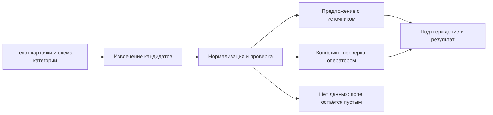

# GoodsAI: концепции проекта

Дата: 14 октября 2026. Основание: текущий репозиторий, требования кейса и уточнение пользователя — сейчас нужен продуктовый прототип. Ниже собраны направления из существующих документов; новые способы проверки помечены как предложения. Это не утверждение о готовых функциях или доказанном спросе.

## Рекомендация

**Основная концепция — помощник контент-оператора, который предлагает недостающие характеристики и показывает, откуда они взяты.** Для небольшого прототипа добавить простую обработку нескольких карточек. Массовую автоматизацию, кабинет продавца и приоритизацию по спросу развивать после проверки основного сценария.

Четыре концепции ниже используют общее ядро извлечения, но отвечают на разные пользовательские задачи. Их не стоит одновременно объявлять составом первого MVP.

## Сравнение

| Концепция | Основной пользователь | Основная задача | Что показать в прототипе | Место в проекте |
| --- | --- | --- | --- | --- |
| A. Помощник оператора | Контент-оператор | Быстрее найти и проверить недостающие характеристики | Одна карточка, значения, цитаты, подтверждение/исправление | Основной продукт сейчас |
| B. Пакетное обогащение каталога | Команда каталога / интеграции | Обработать много карточек по единым правилам | Небольшой пакет и выгрузка результатов | Простое дополнение к A; масштабирование позже |
| C. Помощник продавца | Продавец / контент-менеджер продавца | Исправить карточку до отправки в каталог | Подсказки о пропусках и предложенные значения | Следующий пользовательский сценарий |
| D. Очередь по полезности для поиска | Менеджер качества каталога | Выбрать, какие карточки исправлять первыми | Объяснимая очередь приоритетов | Гипотеза после проверки связей с поисковыми данными |

## A. Помощник контент-оператора — рекомендуемое ядро

**Проблема.** Характеристики могут присутствовать в названии и описании, но отсутствовать в структурированных полях. Оператору приходится искать их и приводить к нужному формату.

**Работа пользователя.** «Когда я проверяю карточку, я хочу быстро увидеть возможное значение и его источник, чтобы принять или исправить его без повторного чтения всего описания».

**Сценарий.** Выбор карточки → проверка обязательных полей категории → предложения с цитатами → принять, исправить или отклонить → итоговый набор характеристик. Конфликт и отсутствие значения показаны отдельно.

**Вход и выход.** Вход: категория, название, описание, допустимые поля продавца. Выход: атрибут, исходное и каноническое значение, источник, статус и действие оператора. В будущем confidence рассчитывается и проверяется на данных; макетный процент явно подписывается как демонстрационный.

**Минимальный показ.** Одна категория, 3–5 характеристик, 10–20 карточек. Для первой версии удобны смартфоны, но это выбор демонстрационного среза, не утверждение о структуре всего каталога. Достаточны три сценария: найдено значение, конфликт, значение отсутствует. Дополнительный пример — совместимость аксессуара с брендом, которая не определяет бренд самого аксессуара.

**Проверка ценности — предложение.** Дать оператору сопоставимые карточки с подсказками и без них; менять порядок режимов, чтобы уменьшить эффект запоминания. Сравнить время на карточку и количество ошибочных/исправленных значений. До исследования не обещать конкретную экономию.

**Риск.** Подсветка цитаты создаёт ложное ощущение гарантии: слово может относиться к другой модели, совместимости или комплекту. Поэтому требуется проверка смысла и возможность отказа.

**Почему начать здесь.** В PROJECT_CONTEXT.md уже выбран этот пользователь, а prototype/index.html показывает близкий экран. Концепцию можно объяснить без обучения модели и интеграции с production-каталогом.

## B. Пакетное обогащение каталога

**Проблема.** Ручная проверка каждой карточки не масштабируется; команде нужен единый формат массовой обработки и понятный остаток для оператора.

**Сценарий.** Загрузка небольшого пакета → извлечение и нормализация → результаты по каждой карточке → выгрузка → отдельные спорные поля для проверки. Существующие подтверждённые значения не должны молча перезаписываться.

**Минимальный показ.** Локальный файл с несколькими карточками, таблица результатов и JSON/CSV-выгрузка. Для прототипа не нужны API, очередь распределённых задач или автоматическая запись в каталог. В этом аудите такой экспорт не реализован.

**Метрики после реализации.** Точность и полнота по атрибутам, покрытие автоматически принятых полей, доля review/abstain, время и стоимость обработки пакета.

**Зависимости.** Схема категории, контракт результата, воспроизводимый запуск и политика конфликтов. Параметры каталога можно рассматривать как кандидаты для разметки только после проверки качества и исключения утечки ответов во вход.

**Решение.** Показывать как способ подачи данных в основной продукт A. Превращать в отдельную массовую платформу сейчас не требуется.

## C. Помощник продавца до публикации карточки

**Проблема.** Продавец не всегда понимает, какие характеристики пропущены и как привести свободный текст к формату площадки.

**Сценарий.** Продавец вводит название и описание → система показывает недостающие поля и подтверждённые текстом предложения → продавец подтверждает или дополняет сведения → карточка готовится к отправке.

**Минимальный показ.** Концептуальный экран с одним пропущенным полем и объяснением. Если значения в тексте нет, запросить его у продавца; извлечение не может восстановить отсутствующий факт.

**Проверка ценности — предложение.** Измерить время заполнения и долю заполненных обязательных полей; качество предложений оценивать отдельно. Подтверждение продавцом не означает автоматического включения значения в эталон без контроля.

**Риски и зависимости.** Нужны доступ к процессу публикации и подтверждение, что продавцу полезен такой шаг. Сценарий меняет главного пользователя и потребует собственного исследования.

**Решение.** Оставить как расширение. Не строить кабинет продавца и seller score до проверки сценария оператора.

## D. Приоритет обработки по полезности для поиска

**Проблема.** При ограниченной работе операторов и моделей хочется сначала исправлять карточки, где это принесёт больше пользы.

**Сценарий.** Менеджер видит карточки с пропусками, сигнал спроса и объяснение приоритета → запускает обработку или отправляет оператору → наблюдает качество и покрытие по сегментам.

**Данные.** В архиве есть query_clicks.parquet, но связи с каталогом, смысл одной строки, период наблюдений и знаменатели показов ещё не проверены. По числу строк нельзя вычислить CTR или доказать эффект для продаж.

**Минимальный показ.** Объяснимая очередь на нескольких примерах. Если порядок задан вручную или синтетическими числами, так и подписать. Не объявлять её работающей аналитикой реального спроса.

**Проверка ценности — предложение.** После проверки данных сравнить две стратегии при одинаковом бюджете: обычную очередь и очередь с приоритетом. Измерять корректно заполненные поля, отдельно контролировать хвост категорий и малых продавцов. Бизнес-эффект потребует отдельной проверки.

**Риск.** Популярные товары получают ещё больше внимания, а длинный хвост остаётся без обработки. Клики также зависят от позиции и текущей доступности товара.

**Решение.** Сильная тема для будущего развития, но преждевременная центральная концепция нынешнего прототипа.

## Общий подход и границы

Первый способ извлечения — правила и словари. После baseline сравнить его с одним ML- или LLM-подходом. Гибрид соответствует направлению кейса, но обязательность всех трёх ступеней rules → encoder → LLM из предоставленных требований не следует. Дорогой fallback добавляется при понятной пользе.

Не включать в ближайший объём изображения/OCR, полноценный кабинет продавца, автоматическую запись в production, retrain-сервис, обязательное дообучение encoder и обработку всего набора поисковых событий.

## Формулировка для чекпоинта

> GoodsAI — прототип помощника контент-оператора. Он предназначен для поиска недостающих характеристик в тексте карточки, приведения их к формату каталога и проверки по исходному фрагменту. Мы показываем, как оператор подтверждает предложение, разбирает конфликт или оставляет поле пустым, если факта нет. Начинаем с одной категории и нескольких характеристик; затем проверим качество извлечения и влияние подсказок на ручную работу.

## Вопросы для выбора следующего шага

1. Основная боль команды каталога — поиск значений, нормализация или разбор противоречий?
2. Кто принимает окончательное решение и какие ошибки наиболее дорогие?
3. Нужны ли эксперту на следующем этапе интерфейс, пакетная выгрузка или оба варианта?
4. Где официальный список обязательных полей, справочники и правила оценки?
5. Какая из концепций C/D имеет подтверждённого пользователя и доступные данные?

Рекомендация A + небольшой пакетный ввод/вывод B является выводом аудита. Она не заменяет принятого командой продуктового решения и не заявляет подтверждённый рынком спрос.
