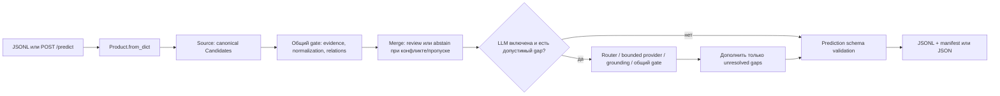
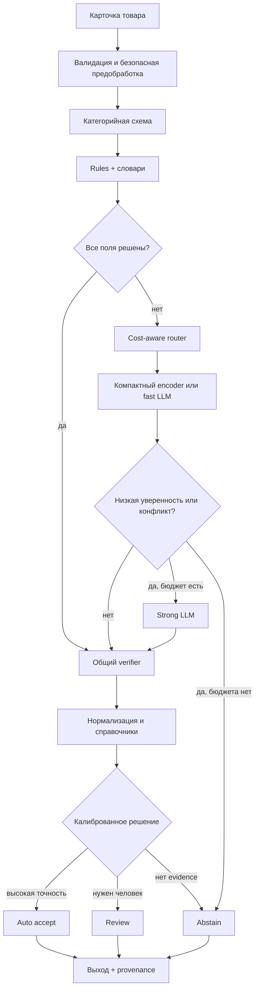
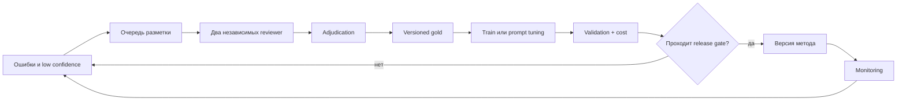

# Архитектура

## Принцип

Гибридность означает, что один pipeline сочетает детерминированные правила,
модельные кандидаты и общую проверку. Это не требование вызвать нейросеть для
каждой карточки. Router тратит дорогой метод только на неразобранные поля.

## Текущий runtime



По умолчанию в этом пути нет LLM и обученного encoder. С флагом `--llm`
(или `GOODSAI_LLM_ENABLED=1` в API) после правил пропуски `not_found_by_rules`
одним запросом уходят в OpenAI-совместимый шлюз; ответ проходит grounding по
цитате и общий `CandidateVerifier`, итог — `method=llm`, `review`
([LLM](LLM.md)). Поле `method=model` в старых отчётах
обозначает rules grammar для явной модели товара, а не ML-модель.

Отдельный [опциональный GLiNER prototype](EXPERIMENTAL_GLINER.md) доступен
только через явно создаваемый HybridExtractor/экспериментальный CLI. Он не
подключён к штатным CLI/API; independent quality и default enable не приняты.

## Целевая архитектура



`Auto accept` на схеме — целевая ветка. В текущем контракте она отключена.

## Компоненты

| Компонент | Сейчас | Следующий шаг |
| --- | --- | --- |
| Input contract | строгий JSON `0.1` | согласовать официальный API |
| Preprocessing | CLI prepare, provenance, manifests, split audit/quarantine | разрешённая train-проекция новых реальных категорий |
| Rules | bounds/scores/limits/aliases в versioned config | новые поля и категории после приёмки |
| Encoder | отдельный opt-in GLiNER brand prototype, default выключен | общий benchmark и независимая проверка |
| LLM adapter | opt-in OpenAI-compatible provider, deadlines/ledger/cache | независимое измерение качества и стоимости |
| Router | SignalRouter для eligible gaps, data policy перед router | измеряемые альтернативы маршрутизации |
| Verifier | общий CandidateVerifier для rules/LLM/cache/experimental model | расширение по подтверждённым ошибкам |
| Normalizer | числа, единицы, aliases | versioned ontology и category ranges |
| Decision | `review`/`abstain` | calibration и безопасный `auto_accept` |
| Storage | atomic predictions + manifest | release artifact registry |
| API | временный FastAPI | официальный batch/transaction contract |

Exact cache TTL/single-flight, source context planner и span selector уже
реализованы как явные opt-in компоненты. Dictionary console, review priority
и drift доступны отдельными entrypoints; это не завершённый общий кабинет
проверки карточек. Условия и ограничения: [EXACT_CACHE](EXACT_CACHE.md),
[CONTEXT_PLANNER](CONTEXT_PLANNER.md), [SPAN_SELECTOR](SPAN_SELECTOR.md),
[DICTIONARY_CONSOLE](DICTIONARY_CONSOLE.md), [REVIEW_PRIORITY](REVIEW_PRIORITY.md),
[DRIFT](DRIFT.md). Representative keep/drop и human UX приёмка ещё открыты.

## Единый Candidate

Действующий `stages.Candidate` v1 содержит каноническое значение и raw evidence:

```text
Candidate(
  attribute,
  value,
  unit,
  field,
  start,
  end,
  text,
  score,
  rule_id
)
```

`method` и `reason_codes` относятся к публичному prediction, а не являются
обязательными полями Candidate. Source выполняет первичную нормализацию;
verifier независимо проверяет её связь с evidence до объединения значений.

Verifier не доверяет `score` метода. Он заново проверяет поле, offsets,
совпадение raw evidence, категорийную схему, единицу и диапазон. После него
merger сохраняет конфликт несовместимых значений вместо выбора по score.

## Router

Маршрутизация выполняется по отдельным атрибутам, чтобы не отправлять в LLM
поля, уже надёжно найденные правилами.

```text
if exact_rule_candidate passes verifier:
    keep candidate
elif model route is enabled and budget allows:
    request only unresolved attributes
else:
    abstain
```

После появления калибровки решение учитывает ожидаемый риск ошибки и стоимость.
Порог определяется на validation и замораживается до test.

## LLM route

LLM получает:

- title и description без target metadata;
- category ID и список нужных полей;
- допустимые единицы/значения и инструкцию отказа;
- требование вернуть quote; raw offsets вычисляются локально, не берутся на веру;
- строгую клиентскую схему ответа без дополнительных полей. В отдельном opt-in
  span selector модель выбирает ID заранее определённого source span.

Выход парсится строго. Неизвестное поле, отсутствующее evidence, несовпавший
span, неверная единица, конфликт или превышение бюджета дают отказ. Retries
ограничены и учитываются в стоимости.

## Цикл данных и обучения



Операторские исправления не попадают в обучение автоматически. Сначала они
проверяются, дедуплицируются и получают версию инструкции.

## Потоки отказа

| Ситуация | Поведение |
| --- | --- |
| неизвестная категория | `unsupported_category` |
| невалидный вход | `invalid_input` без текста в логах |
| значения конфликтуют | `abstain: conflicting_evidence` |
| LLM недоступна/дорога | rules-result или `abstain` |
| схема LLM неверна | reject без retry по причине ошибки схемы; rules сохраняются |
| evidence не найден | reject |
| запись output прервана | предыдущая согласованная пара сохраняется |
| второй writer | явная ошибка блокировки |

## Карта кода

| Путь | Назначение |
| --- | --- |
| `contracts.py` | вход, конфиг и инварианты выхода |
| `data.py` | подготовка и I/O |
| `rules.py`, `model_rules.py` | детерминированные кандидаты |
| `normalize.py` | единицы и канонические значения |
| `verify.py` | merge, конфликт и финальная проверка |
| `stages.py`, `composition.py` | typed boundaries и единая сборка CLI/API |
| `candidate_verifier.py`, `routing.py` | фабрика общих gate и signal router |
| `evaluate.py` | метрики и slices |
| `storage.py` | атомарная публикация output |
| `runtime.py` | manifest и измерения процесса |
| `cli.py`, `api.py` | batch и HTTP transport |
| `demo.py` | сквозная синтетическая проверка |

## Решения, требующие ADR

Отдельное архитектурное решение нужно перед изменением schema version,
добавлением `auto_accept`, выбором encoder, передачей реальных данных LLM,
изменением official API или переносом release-источника. Решение фиксируется
в PR и в `docs/PROJECT_STATUS.md`; отдельный каталог ADR появится, когда таких
решений станет больше трёх.

## ARCH-001: внутренний контракт этапов v1

Начальные CandidateSource/CandidateGate/CategoryRegistry Тимура сохранены.
`stages.py` также содержит Predictor, ValueNormalizer, GateFactory, Router,
Provider/ProviderResponse и PredictionSink. Protocol используют структурную
типизацию; JSON/env не загружают классы или произвольный код. Candidate из
`rules` и ProviderResponse из `llm` доступны как прежние aliases.

`composition.build_runtime(config, policy, components=Components(...))` —
одна точка сборки для batch CLI, HTTP и synthetic trace. Она валидирует и
копирует профиль/политику, создаёт registry, source, normalizer, фабрику gate,
predictor и sink. Opt-in ветка добавляет router и provider. Environment
precedence разрешается entrypoint до сборки; ключ читает только live provider
factory при включённом LLM. В rules-only factory провайдера не вызывается.

| Граница | Реализация по умолчанию | Замена для offline-проверки |
| --- | --- | --- |
| CandidateSource | Rules с явным профилем | fake/model `.candidates(Product)` |
| ValueNormalizer | Registry.normalize с bounds профиля | совместимый canonical normalizer |
| GateFactory → CandidateGate | VerifierFactory → CandidateVerifier | factory с тем же evidence/relation контрактом |
| Predictor | Extractor; при opt-in LLMExtractor | композиция над Predictor без `.rules.rules` |
| Router | SignalRouter + has_signal | selector подмножества eligible gaps |
| Provider | OpenAICompatibleProvider | bounded offline provider с ProviderResponse |
| PredictionSink | FilePredictionSink | context adapter staging пары |

Source возвращает уже нормализованный Candidate; gate сопоставляет значение
с raw/visible evidence, используя normalizer для числовых единиц. Новая
реализация source сама выполняет первичную нормализацию по выбранному профилю.
Подмена source не подменяет поддержку/verifier grammar: для неё отдельный Rules
экземпляр. Общий gate применяется перед merge и к fresh/cache LLM-кандидатам.
Trusted structural bugs источника по-прежнему приводят к ошибке, а не успешному
пустому результату. Конфликты дают abstain; score остаётся heuristic/review.

LLMExtractor и экспериментальный HybridExtractor принимают Predictor и
GateFactory явно; у внедрённого predictor не требуется config или Rules.
Проверка source_flags выполняется до router. Router не может запросить уже
решённое/конфликтное поле, повторить его или обойти закрытый test. Проверки
бюджета/deadline/cache/provider ошибок остаются внутри существующего LLM пути.
Неудача провайдера сохраняет rules-result и фиксированный reason code.

Batch использует sink для той же транзакционной публикации predictions/manifest,
блокировок и recovery на локальной ФС. HTTP возвращает JSON, не сохраняет
файловую пару. Неподдерживаемые сетевые ФС этим refactor не становятся
поддерживаемыми. Замена sink — доверенная интеграция, которая обязана сохранить
контракт успешного выхода и отката при исключении.

```python
from goodsai.composition import Components, build_runtime

# candidate_model implements candidates(Product); no orchestration change.
runtime = build_runtime(config, components=Components(source=candidate_model))
prediction = runtime.predictor.predict(product, run_id="offline-comparison")
```

Для Python batch API доступны `predict(..., components=Components(...))`,
для HTTP `create_app(config_path, components=Components(...))`. Legacy
`predict(..., llm=existing)` сохраняет экземпляр, cache и counters; несовпадение
профиля/settings с runtime policy отклоняется до записи. Обычные команды CLI,
systemd и HTTP endpoints не меняются. Тестовые providers не являются новым
runtime режимом CLI и не выдают synthetic результаты за model quality.

Совместимость: публичный schema v0.1, config v1 и opt-in registry config v2,
runtime policy v1, внутренний stage v1. Legacy config мигрирует существующим
валидатором; неизвестные версии, частичные профили и auto_accept запрещены.
Добавлены Protocol, но обязательные поля Candidate/методы source не изменены.
Официальное подтверждение SPEC-001 #10 этим не закрывается; CONF-002 уже принят.

Проверки: `tests/test_composition.py` и `tests/test_stages.py`: замена source на
model-shaped fake в CLI/API, parity профиля и provider/router, offline failure,
общая factory, normalizer, rollback sink, запрет test/перезаписи, legacy aliases,
копирование config/policy, отсутствие eager import cycles и optional ML imports.
Это рефакторинг сборки: измеримого прироста извлечения или баллов не заявляет.
