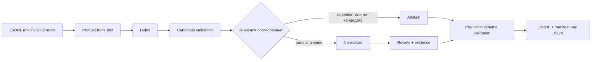
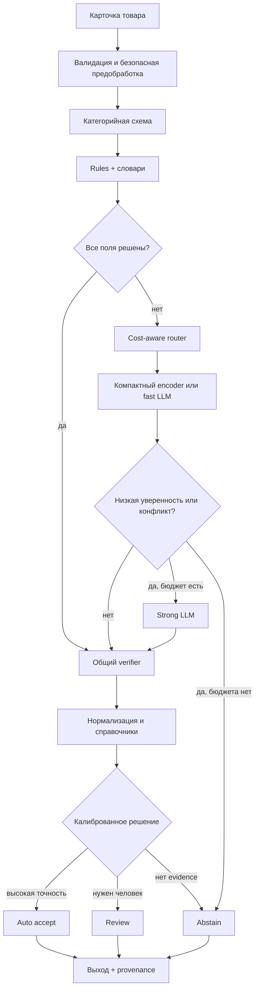
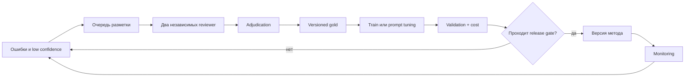

# Архитектура

## Принцип

Гибридность означает, что один pipeline сочетает детерминированные правила,
модельные кандидаты и общую проверку. Это не требование вызвать нейросеть для
каждой карточки. Router тратит дорогой метод только на неразобранные поля.

## Текущий runtime



В этом пути нет LLM и обученного encoder. Поле `method=model` в старых отчётах
обозначает rules grammar для явной модели товара, а не ML-модель.

Отдельный [опциональный GLiNER prototype](EXPERIMENTAL_GLINER.md) доступен
только через явно создаваемый HybridExtractor/экспериментальный CLI. Он не
подключён к штатным CLI/API; independent quality и default enable не приняты.

## Целевая архитектура



`Auto accept` на схеме — целевая ветка. В текущем контракте она отключена.

## Компоненты

| Компонент | Сейчас | Следующий шаг |
| --- | --- | --- |
| Input contract | строгий JSON `0.1` | согласовать официальный API |
| Preprocessing | CLI prepare, provenance, manifests | дубли, split audit, category configs |
| Rules | работает | вынести все пороги и словари в конфиг |
| Encoder | отсутствует | эксперимент после независимого gold |
| LLM adapter | отсутствует | OpenAI-compatible client, schema, budget |
| Router | отсутствует | rules-first по полям, причины маршрута |
| Verifier | rules candidate и output validation | relation/negation/compatibility checks для всех методов |
| Normalizer | числа, единицы, aliases | versioned ontology и category ranges |
| Decision | `review`/`abstain` | calibration и безопасный `auto_accept` |
| Storage | atomic predictions + manifest | release artifact registry |
| API | временный FastAPI | официальный batch/transaction contract |

## Единый Candidate

Все методы должны возвращать внутренний объект одинакового смысла:

```text
Candidate(
  attribute,
  raw_value,
  normalized_value,
  unit,
  source_field,
  start,
  end,
  evidence_text,
  method,
  method_version,
  score,
  reason_codes
)
```

Verifier не доверяет `score` метода. Он заново проверяет поле, offsets,
совпадение raw evidence, категорийную схему, единицу, диапазон и конфликты.

## Router

Маршрутизация выполняется по отдельным атрибутам, чтобы не отправлять в LLM
поля, уже надёжно найденные правилами.

```text
if exact_rule_candidate passes verifier:
    keep candidate
elif model route is enabled and budget allows:
    request only unresolved attributes
else:
    abstain
```

После появления калибровки решение учитывает ожидаемый риск ошибки и стоимость.
Порог определяется на validation и замораживается до test.

## LLM route

LLM получает:

- title и description без target metadata;
- category ID и список нужных полей;
- допустимые единицы/значения и инструкцию отказа;
- требование вернуть exact quote и offsets;
- JSON schema без свободного текста.

Выход парсится строго. Неизвестное поле, отсутствующее evidence, несовпавший
span, неверная единица, конфликт или превышение бюджета дают отказ. Retries
ограничены и учитываются в стоимости.

## Цикл данных и обучения



Операторские исправления не попадают в обучение автоматически. Сначала они
проверяются, дедуплицируются и получают версию инструкции.

## Потоки отказа

| Ситуация | Поведение |
| --- | --- |
| неизвестная категория | `unsupported_category` |
| невалидный вход | `invalid_input` без текста в логах |
| значения конфликтуют | `abstain: conflicting_evidence` |
| LLM недоступна/дорога | rules-result или `abstain` |
| схема LLM неверна | reject, один ограниченный retry |
| evidence не найден | reject |
| запись output прервана | предыдущая согласованная пара сохраняется |
| второй writer | явная ошибка блокировки |

## Карта кода

| Путь | Назначение |
| --- | --- |
| `contracts.py` | вход, конфиг и инварианты выхода |
| `data.py` | подготовка и I/O |
| `rules.py`, `model_rules.py` | детерминированные кандидаты |
| `normalize.py` | единицы и канонические значения |
| `verify.py` | merge, конфликт и финальная проверка |
| `evaluate.py` | метрики и slices |
| `storage.py` | атомарная публикация output |
| `runtime.py` | manifest и измерения процесса |
| `cli.py`, `api.py` | batch и HTTP transport |
| `demo.py` | сквозная синтетическая проверка |

## Решения, требующие ADR

Отдельное архитектурное решение нужно перед изменением schema version,
добавлением `auto_accept`, выбором encoder, передачей реальных данных LLM,
изменением official API или переносом release-источника. Решение фиксируется
в PR и в `docs/PROJECT_STATUS.md`; отдельный каталог ADR появится, когда таких
решений станет больше трёх.
