# Данные и предобработка

## Источники

Выданный архив хранится локально и не входит в Git. Исследованные источники
содержат каталог SKU, описания и дополнительные parquet/pickle файлы. Pickle
считается доверенным только после проверки происхождения и отдельного scan;
основной pipeline использует безопасную проекцию Parquet/JSONL.

По последнему сохранённому EDA:

- каталог содержит 148 871 карточку;
- рабочий пилот E1 содержит 10 324 SKU двух категорий;
- у 4 244 SKU есть description, у 6 080 его нет;
- для 343 сопоставленных SKU источники title различаются;
- поля `param` неоднородны и иногда имеют другой тип;
- готовые характеристики являются слабыми метками, а не ручным gold.

Эти числа относятся к конкретным локальным копиям. Перед новым экспериментом
их подтверждает manifest с SHA-256.

## Pipeline подготовки

```mermaid
flowchart LR
    A[Исходные файлы] --> B[Inventory + SHA-256]
    B --> C[Schema/type scan]
    C --> D[Безопасная Parquet-проекция]
    D --> E[Join по SKU]
    E --> F[Text cleaning + raw offset map]
    F --> G[Category filter]
    G --> H[Deduplication groups]
    H --> I[Development / validation / test]
    I --> J[JSONL + provenance + manifest]
```

Схема ниже описывает подготовку и контроль split в целом. Это не одна уже
реализованная команда: `goodsai prepare` проверяет источники, фильтрует категории
и соединяет SKU; grouping/quarantine/split выполняются отдельными research tools.
Полный аудит near-duplicates и независимая gold-оценка остаются открыты.



## Подготовка проекции

Обычный путь — использовать существующую доверенную
`outputs/eda/catalog_skus.parquet`, opcode scan и сохранённый inventory.
Проверить hashes источников и provenance прежней подготовки до нового запуска.
`goodsai prepare` не загружает pickle и не создаёт проекцию автоматически.
Нужные колонки проекции: `sku_id`, `category_ids`, `title`, `vendor`, `model`,
`seller`; `category_ids` — JSON-строка со списком категорий. Vendor/model/seller
попадают только в отдельный provenance, не во вход Extractor.

Только если проекции нет и происхождение `skus.pkl` подтверждено, в отдельном
чистом checkout можно использовать существующие исследовательские инструменты.
Это повторное чтение/профилирование каталога; для обычного запуска и этапа DOCS-001
оно не требуется и здесь не выполнялось. Reader привязан к проверенному plain-
container pickle и CPython 3.12, запрещает object construction и неподдержанные
opcodes, но не является универсальной песочницей для неизвестных файлов.

Из корня отдельного checkout, с выданными файлами в `data/raw/`:

```bash
test ! -e outputs/eda &&
.venv/bin/python scripts/research/inspect_pickle.py data/raw/skus.pkl outputs/eda/pickle_opcodes.json &&
.venv/bin/python scripts/research/profile_catalog.py --trusted-pickle
```

Для PowerShell проверку существования выполнить отдельно:

```powershell
if (Test-Path outputs/eda) { throw 'Existing EDA: inspect provenance and reuse it; do not overwrite' }
.\.venv\Scripts\python.exe scripts/research/inspect_pickle.py data/raw/skus.pkl outputs/eda/pickle_opcodes.json
if ($LASTEXITCODE -ne 0) { throw 'Opcode inspection failed' }
.\.venv\Scripts\python.exe scripts/research/profile_catalog.py --trusted-pickle
```

Reader проверяет source SHA по scan, создаёт `catalog_skus.parquet` и
`catalog_profile.json`. Ошибка/незнакомый opcode — остановка и разбор,
не fallback на `pickle.load`. Не перезаписывать существующие outputs.

Дальнейшие команды inventory/prepare — в [README](../README.md#подготовка-данных).
Inventory хранится **вне data/raw**, и тот же путь передаётся `--inventory`.
`inventory` фиксирует hashes текущих файлов, а не удостоверяет их происхождение.
При наличии старого доверенного inventory сначала сверить его с источниками;
не заменять его новым ради обхода mismatch. Не публиковать EDA profile с локальными
примерами атрибутов или входными текстами.

## Обязательные проверки

| Этап | Проверка | Реакция |
| --- | --- | --- |
| Inventory | имя, размер, SHA, дата | остановка при неожиданной версии |
| Schema | колонки и типы | отчёт и явная миграция |
| Text | null, пустые, HTML, Unicode, длина | нормализация с raw mapping |
| Join | уникальность SKU, unmatched, title mismatch | provenance и счётчики |
| Parameters | list/dict, повторы, неизвестные единицы | карантин слабых меток |
| Duplicates | exact и normalized text, product family | один group в одном split |
| Leakage | target columns и exposed examples | исключение из независимого test |
| Output | строка на каждый SKU, стабильный порядок | fail run при нарушении |

## Политика split

Нельзя случайно делить отдельные SKU, если это варианты или дубли одного
товара. Group ID строится из нормализованного текста, известных product family
и кандидатов near-duplicate. Группа целиком попадает в один split.

- `development` — анализ ошибок, правила, prompt и обучение;
- `validation` — выбор версии, route и порогов;
- `test_reserved` — одно открытие после заморозки всех решений.

Прежний reviewed-v2 validation уже использовался для исправлений и теперь
трактуется как `development_feedback`, даже если поле split в старом файле
осталось `validation`. Действующий резерв M2 — v2, 40 карточек; отбор v1
не использовать. Provenance и ограничения — в [RESULTS](RESULTS.md#резерв-test-и-незавершённые-задачи).

Карточки, показанные модели или разработчику вместе с ответами, получают флаг
exposed и не могут подтверждать независимое качество.

## Разметка

Для каждой пары `(SKU, attribute)` фиксируются:

- `present`, `absent` или `ambiguous`;
- каноническое значение и единица;
- один raw evidence span для present-поля в текущем E1/v0.1;
- причина ambiguity/конфликта;
- annotator, reviewer, время и версия инструкции;
- происхождение: blind human, AI-assisted review или weak label.

Финальный gold требует слепой человеческой разметки. AI-assisted набор полезен
для разработки, но не становится независимым test после поверхностной проверки.
Массив spans потребовал бы отдельного изменения схемы; сейчас его нет.

## Пропуски и конфликты

- Отсутствующее значение остаётся отсутствующим.
- Явно разные значения title и description дают конфликт.
- Разные формы одного значения нормализуются только по утверждённой таблице.
- Внешний веб-контекст не подставляется в text-only gold.
- Общая маркетинговая характеристика не заменяет конкретное значение.
- Характеристика совместимого устройства не относится к основному товару.

## Артефакты вне Git

```text
data/raw/                         исходные файлы
data/processed/                   разрешённый вход и provenance
data/gold/                        задания, split и reference
outputs/eda/                      профили и безопасные агрегаты
outputs/experiments/              predictions, metrics, manifests
models/                           веса и tokenizer
```

В Git разрешены только синтетические примеры, код, схемы и агрегаты без текста
реальных карточек. Перед передачей артефакта организаторам проверяется отдельное
правило канала сдачи.

## Definition of Done предобработки

Подготовка завершена, если свежий manifest связывает hashes источников с
выходным JSONL, схема воспроизводится одной командой, дубли и split проверены,
target leakage исключена, все потери строк объяснены, а реальные тексты и
секреты не попали в Git и логи.
