# Данные и предобработка

## Источники

Выданный архив хранится локально и не входит в Git. Исследованные источники
содержат каталог SKU, описания и дополнительные parquet/pickle файлы. Pickle
считается доверенным только после проверки происхождения и отдельного scan;
основной pipeline использует безопасную проекцию Parquet/JSONL.

По последнему сохранённому EDA:

- каталог содержит 148 871 карточку;
- рабочий пилот E1 содержит 10 324 SKU двух категорий;
- у 4 244 SKU есть description, у 6 080 его нет;
- для 343 сопоставленных SKU источники title различаются;
- поля `param` неоднородны и иногда имеют другой тип;
- готовые характеристики являются слабыми метками, а не ручным gold.

Эти числа относятся к конкретным локальным копиям. Перед новым экспериментом
их подтверждает manifest с SHA-256.

## Pipeline подготовки

```mermaid
flowchart LR
    A[Исходные файлы] --> B[Inventory + SHA-256]
    B --> C[Schema/type scan]
    C --> D[Безопасная Parquet-проекция]
    D --> E[Join по SKU]
    E --> F[Text cleaning + raw offset map]
    F --> G[Category filter]
    G --> H[Deduplication groups]
    H --> I[Development / validation / test]
    I --> J[JSONL + provenance + manifest]
```



## Обязательные проверки

| Этап | Проверка | Реакция |
| --- | --- | --- |
| Inventory | имя, размер, SHA, дата | остановка при неожиданной версии |
| Schema | колонки и типы | отчёт и явная миграция |
| Text | null, пустые, HTML, Unicode, длина | нормализация с raw mapping |
| Join | уникальность SKU, unmatched, title mismatch | provenance и счётчики |
| Parameters | list/dict, повторы, неизвестные единицы | карантин слабых меток |
| Duplicates | exact и normalized text, product family | один group в одном split |
| Leakage | target columns и exposed examples | исключение из независимого test |
| Output | строка на каждый SKU, стабильный порядок | fail run при нарушении |

## Политика split

Нельзя случайно делить отдельные SKU, если это варианты или дубли одного
товара. Group ID строится из нормализованного текста, известных product family
и кандидатов near-duplicate. Группа целиком попадает в один split.

- `development` — анализ ошибок, правила, prompt и обучение;
- `validation` — выбор версии, route и порогов;
- `test_reserved` — одно открытие после заморозки всех решений.

Карточки, показанные модели или разработчику вместе с ответами, получают флаг
exposed и не могут подтверждать независимое качество.

## Разметка

Для каждой пары `(SKU, attribute)` фиксируются:

- `present`, `absent` или `ambiguous`;
- каноническое значение и единица;
- один или несколько raw evidence spans;
- причина ambiguity/конфликта;
- annotator, reviewer, время и версия инструкции;
- происхождение: blind human, AI-assisted review или weak label.

Финальный gold требует слепой человеческой разметки. AI-assisted набор полезен
для разработки, но не становится независимым test после поверхностной проверки.

## Пропуски и конфликты

- Отсутствующее значение остаётся отсутствующим.
- Явно разные значения title и description дают конфликт.
- Разные формы одного значения нормализуются только по утверждённой таблице.
- Внешний веб-контекст не подставляется в text-only gold.
- Общая маркетинговая характеристика не заменяет конкретное значение.
- Характеристика совместимого устройства не относится к основному товару.

## Артефакты вне Git

```text
data/raw/                         исходные файлы
data/processed/                   разрешённый вход и provenance
data/gold/                        задания, split и reference
outputs/eda/                      профили и безопасные агрегаты
outputs/experiments/              predictions, metrics, manifests
models/                           веса и tokenizer
```

В Git разрешены только синтетические примеры, код, схемы и агрегаты без текста
реальных карточек. Перед передачей артефакта организаторам проверяется отдельное
правило канала сдачи.

## Definition of Done предобработки

Подготовка завершена, если свежий manifest связывает hashes источников с
выходным JSONL, схема воспроизводится одной командой, дубли и split проверены,
target leakage исключена, все потери строк объяснены, а реальные тексты и
секреты не попали в Git и логи.
