# Данные и предобработка

## Источники

По [SPEC-001](../TECHNICAL_SPEC.md#0-действующая-политика-команды--spec-001)
исходные текстовые атрибуты продавца разрешены кейсом, но не реализованы в E1.
До DATA-002 используем прежний title/description input. Для каждой будущей
seller-колонки нужны source/hash, происхождение до каталожного обогащения,
доступность на inference и отделение от reference. Поля vendor/model/params
не становятся seller input только из-за названия; их перенос в description
для обхода Product запрещён. DATA-001 не получает разрешения менять эту границу.

Выданный архив хранится локально и не входит в Git. Исследованные источники
содержат каталог SKU, описания и дополнительные parquet/pickle файлы. Pickle
считается доверенным только после проверки происхождения и отдельного scan;
основной pipeline использует безопасную проекцию Parquet/JSONL.

По последнему сохранённому EDA:

- каталог содержит 546 069 карточек с уникальными SKU;
- у 148 871 карточки повторяются названия параметров (это не размер каталога);
- рабочий пилот E1 содержит 10 324 SKU двух категорий;
- у 4 244 SKU есть description, у 6 080 его нет;
- для 343 сопоставленных SKU источники title различаются;
- поля `param` неоднородны и иногда имеют другой тип;
- готовые характеристики являются слабыми метками, а не ручным gold.

Эти числа относятся к конкретным локальным копиям. Перед новым экспериментом
их подтверждает manifest с SHA-256.
Число каталога уточнено по `catalog_profile.json`, `joins_profile.json` и footer
существующей Parquet-проекции. Прежнее сокращённое описание ошибочно принимало
число SKU с повторами параметров за число всех карточек; полный EDA не повторялся.

## Pipeline подготовки

```mermaid
flowchart LR
    A[Исходные файлы] --> B[Inventory + SHA-256]
    B --> C[Schema/type scan]
    C --> D[Безопасная Parquet-проекция]
    D --> E[Join по SKU]
    E --> F[Text cleaning + raw offset map]
    F --> G[Category filter]
    G --> H[Deduplication groups]
    H --> I[Development / validation / test]
    I --> J[JSONL + provenance + manifest]
```

`goodsai prepare` проверяет источники, фильтрует категории и соединяет SKU.
DATA-001 добавляет одну команду handoff: она повторяет подготовку и проверяет
её связь с существующим frozen EVAL-002 аудитом exact/normalized/near-дублей,
families, exposure и quarantine. Новые split assignments не создаются;
независимая gold-оценка остаётся отдельной задачей.



## Подготовка проекции

Обычный путь — использовать существующую доверенную
`outputs/eda/catalog_skus.parquet`, opcode scan и сохранённый inventory.
Проверить hashes источников и provenance прежней подготовки до нового запуска.
`goodsai prepare` не загружает pickle и не создаёт проекцию автоматически.
Нужные колонки проекции: `sku_id`, `category_ids`, `title`, `vendor`, `model`,
`seller`; `category_ids` — JSON-строка со списком категорий. Vendor/model/seller
попадают только в отдельный provenance, не во вход Extractor.

Только если проекции нет и происхождение `skus.pkl` подтверждено, в отдельном
чистом checkout можно использовать существующие исследовательские инструменты.
Это повторное чтение/профилирование каталога; для обычного запуска и этапа DOCS-001
оно не требуется и здесь не выполнялось. Reader привязан к проверенному plain-
container pickle и CPython 3.12, запрещает object construction и неподдержанные
opcodes, но не является универсальной песочницей для неизвестных файлов.

Из корня отдельного checkout, с выданными файлами в `data/raw/`:

```bash
test ! -e outputs/eda &&
.venv/bin/python scripts/research/inspect_pickle.py data/raw/skus.pkl outputs/eda/pickle_opcodes.json &&
.venv/bin/python scripts/research/profile_catalog.py --trusted-pickle
```

Для PowerShell проверку существования выполнить отдельно:

```powershell
if (Test-Path outputs/eda) { throw 'Existing EDA: inspect provenance and reuse it; do not overwrite' }
.\.venv\Scripts\python.exe scripts/research/inspect_pickle.py data/raw/skus.pkl outputs/eda/pickle_opcodes.json
if ($LASTEXITCODE -ne 0) { throw 'Opcode inspection failed' }
.\.venv\Scripts\python.exe scripts/research/profile_catalog.py --trusted-pickle
```

Reader проверяет source SHA по scan, создаёт `catalog_skus.parquet` и
`catalog_profile.json`. Ошибка/незнакомый opcode — остановка и разбор,
не fallback на `pickle.load`. Не перезаписывать существующие outputs.

Дальнейшие команды inventory/prepare — в [README](../README.md#подготовка-данных).
Inventory хранится **вне data/raw**, и тот же путь передаётся `--inventory`.
`inventory` фиксирует hashes текущих файлов, а не удостоверяет их происхождение.
При наличии старого доверенного inventory сначала сверить его с источниками;
не заменять его новым ради обхода mismatch. Не публиковать EDA profile с локальными
примерами атрибутов или входными текстами.

### Профили источников и запись

- `inventory --profile text-only` (по умолчанию): обязательны `skus.pkl` и
  `sku_desc.parquet`. Наличие clicks записывается как optional/unused; файл
  не читается и его отсутствие не мешает подготовке.
- `inventory --profile analytics`: обязательны все три файла, включая clicks.
- `--verify-against <existing-inventory>` проверяет hashes старого доверенного
  inventory до создания нового. Поддерживаются прежние inventory без поля
  `profile`. Новое fingerprinting само по себе не доказывает происхождение.
- `inventory` не перезаписывает существующий файл. `prepare` принимает только
  новый каталог; при Parquet/schema/hash/write ошибке опубликованного
  частичного комплекта нет. Используются локальная OS-блокировка, staging
  и переименование каталога на той же ФС. Поддержка NFS/SMB не заявляется.
- Default `prepare --inventory` совпадает с default `inventory --output`:
  `data/processed/source_inventory.json`. Старый путь можно передать явно.

`prepare-v2` сохраняет прежний побайтовый JSONL и provenance. Он проверяет
необходимые Parquet-колонки и типы, пустые/повторные SKU и выбранные titles,
однозначную категорию, duplicate description IDs и hashes до/после чтения.
Некорректная запись останавливает весь запуск; скрытого удаления строки нет.
Каталог title имеет приоритет; description join выполняется по SKU. Пробельное
description становится null; исходные непустые Unicode/HTML остаются без
изменений для точных evidence offsets. Null metadata не дописываются во вход.

Manifest содержит схемы, source/inventory/projection/config/tool SHA-256,
версию Python, hashes JSONL/provenance, counts по категориям и accounting:
все catalog rows = selected + filtered; отдельно matched/unmatched/blank
descriptions и отсутствие description row. Выбранные SKU не теряются.
Готовые params не читаются; vendor/model/seller остаются только в приватном
provenance. Историческая проекция наследует доверие локальному EDA; проверка
новых hashes не превращает её в независимо удостоверенный источник.

### Одна команда подготовки и проверки frozen split

После inventory и при наличии существующего EVAL-002 bundle:

```bash
.venv/bin/python scripts/research/prepare_dataset.py --inventory data/processed/source_inventory.json --split-audit outputs/evaluation/eval-002-20261019-final --output-dir data/processed/data001-next
```

PowerShell: замените `.venv/bin/python` на `.\.venv\Scripts\python.exe`.
`--catalog`, `--descriptions` и `--config` позволяют явно выбрать источники
и разрешённый профиль. При изменении входного JSONL старая привязка отклоняется.

Выход: `prepared/pilot.jsonl`, `prepared/provenance.jsonl`,
`prepared/prepare_manifest.json`, `dataset.manifest.json`.
Последний связывает hashes файлов с проверенным audit summary, детекторами,
near-порогами, eligible/quarantine counts и ограничениями аудита. Он не содержит
текстов, labels или новых predictions. Приватный pilot включает весь прежний
набор; для обучения/оценки использовать eligible ledger с учётом quarantine,
не все строки pilot. Старый резерв, gold и assignments не изменяются.

Проверка источников, выходов и привязки без подготовки и predictions:

```bash
.venv/bin/python scripts/research/prepare_dataset.py --inventory data/processed/source_inventory.json --split-audit outputs/evaluation/eval-002-20261019-final --verify data/processed/data001-next
```

Оба режима возвращают только агрегаты. Нужны прежние source paths аудитора;
для переноса между машинами подготовьте проверенный handoff EVAL-002, не
редактируйте его manifest. При отсутствии аудита можно получить text-only
JSONL через `goodsai prepare`, но его `split_status=not_checked` не доказывает
отсутствия утечки. Нельзя снимать это ограничение переименованием файла.

### Проверенный локальный прогон DATA-001, 21.10.2026

Без повторного pickle loading или полного EDA подготовлены **10 324** строки
(7 988 смартфонов, 2 336 чайников). 4 244 с description, 6 080 title-only,
343 title mismatch. Из 546 069 catalog rows отфильтрованы 535 745 строк других
категорий; выбранные строки не потеряны. 1 177 200 description rows проверены
на уникальность SKU; с пилотом сопоставлены 4 244, остальные 1 172 956 не входят
в выбранный набор. Это left join от каталога, не потеря выбранных товаров.

Повторная подготовка дала побайтово одинаковые pilot/provenance. Вход совпал
с ранее замороженным EVAL-002 аудитом: eligible 3 411, quarantine 6 913;
старый reserve и assignments не изменялись. Проверка handoff `--verify` PASS.

| Артефакт | SHA-256 |
| --- | --- |
| skus.pkl | `7dd8da31382016c770877e16fbcce565e29e479ad6a6317f0a7e683a09eb3524` |
| sku_desc.parquet | `08af4442a87dd2d0e50d80aae4371b12d72d9f82adfeffeca3c0fff5595bc67d` |
| trusted catalog projection | `2a80d0f0c55a37458faed6638bebc3af417c35e2d8de0265cbd5c023bdf6c250` |
| pilot.jsonl | `68875ae2ef66c3527915be0e2cca29639c4a1c792e359973ae8623a404b70fe3` |
| provenance.jsonl | `e481d719eca0b92652992f23ccb00774e571644d19b6fcc49b14c3fa1a3d32b8` |

Среда — локальный Windows, Python 3.12; это не новый запуск на целевой VM.
Он подтверждает подготовку на тех же исходных fingerprints, но не новое
качество извлечения, не human gold и не поддержку новых категорий. Приватные
manifest/JSONL остаются вне Git. На VM нужен тот же проверенный input/audit
handoff; pipeline ничего не скачивает и не восстанавливает за пользователя.

## Обязательные проверки

| Этап | Проверка | Реакция |
| --- | --- | --- |
| Inventory | имя, размер, SHA, дата | остановка при неожиданной версии |
| Schema | колонки и типы | отчёт и явная миграция |
| Text | null, пустые, HTML, Unicode, длина | нормализация с raw mapping |
| Join | уникальность SKU, unmatched, title mismatch | provenance и счётчики |
| Parameters | list/dict, повторы, неизвестные единицы | карантин слабых меток |
| Duplicates | exact и normalized text, product family | один group в одном split |
| Leakage | target columns и exposed examples | исключение из независимого test |
| Output | строка на каждый SKU, стабильный порядок | fail run при нарушении |

## Политика split

Нельзя случайно делить отдельные SKU, если это варианты или дубли одного
товара. Group ID строится из нормализованного текста, известных product family
и кандидатов near-duplicate. Группа целиком попадает в один split.

- `development` — анализ ошибок, правила, prompt и обучение;
- `validation` — выбор версии, route и порогов;
- `test_reserved` — одно открытие после заморозки всех решений.

Прежний reviewed-v2 validation уже использовался для исправлений и теперь
трактуется как `development_feedback`, даже если поле split в старом файле
осталось `validation`. Действующий резерв M2 — v2, 40 карточек; отбор v1
не использовать. Provenance и ограничения — в [RESULTS](RESULTS.md#резерв-test-и-незавершённые-задачи).

Карточки, показанные модели или разработчику вместе с ответами, получают флаг
exposed и не могут подтверждать независимое качество.

## Разметка

Для каждой пары `(SKU, attribute)` фиксируются:

- `present`, `absent` или `ambiguous`;
- каноническое значение и единица;
- один raw evidence span для present-поля в текущем E1/v0.1;
- причина ambiguity/конфликта;
- annotator, reviewer, время и версия инструкции;
- происхождение: blind human, AI-assisted review или weak label.

Финальный gold требует слепой человеческой разметки. AI-assisted набор полезен
для разработки, но не становится независимым test после поверхностной проверки.
Массив spans потребовал бы отдельного изменения схемы; сейчас его нет.

## Пропуски и конфликты

- Отсутствующее значение остаётся отсутствующим.
- Явно разные значения title и description дают конфликт.
- Разные формы одного значения нормализуются только по утверждённой таблице.
- Внешний веб-контекст не подставляется в text-only gold.
- Общая маркетинговая характеристика не заменяет конкретное значение.
- Характеристика совместимого устройства не относится к основному товару.

## Артефакты вне Git

```text
data/raw/                         исходные файлы
data/processed/                   разрешённый вход и provenance
data/gold/                        задания, split и reference
outputs/eda/                      профили и безопасные агрегаты
outputs/experiments/              predictions, metrics, manifests
models/                           веса и tokenizer
```

В Git разрешены только синтетические примеры, код, схемы и агрегаты без текста
реальных карточек. Перед передачей артефакта организаторам проверяется отдельное
правило канала сдачи.

## Definition of Done предобработки

Подготовка завершена, если свежий manifest связывает hashes источников с
выходным JSONL, схема воспроизводится одной командой, дубли и split проверены,
target leakage исключена, все потери строк объяснены, а реальные тексты и
секреты не попали в Git и логи.
